# EduCasheer Kashmiri Automatic Speech Recognition (ASR) Research Project

[](https://huggingface.co/facebook/wav2vec2-xls-r-300m)
[](#)
[](#)
[](#)
[](#)

EduCasheer Kashmiri ASR is an advanced, production-grade deep learning research framework dedicated to speech recognition, linguistic normalization, acoustic modeling, language model shallow fusion, and dual romanization for the Kashmiri language (**کٲشُر** / *Koshur*).

---

## 🧭 Fast Navigation

| Document | Purpose & Description |
| :--- | :--- |
| **[`PROJECT_MAP.md`](PROJECT_MAP.md)** | Complete structural map of all directories, code modules, and live runtime dependencies |
| **[`EXPERIMENT_REGISTRY.md`](EXPERIMENT_REGISTRY.md)** | Exhaustive index of all research experiments (B-01 through Stage 15), architectures, and metrics |
| **[`DATASET_REGISTRY.md`](DATASET_REGISTRY.md)** | Comprehensive index of 106k+ speech samples, manifests, licenses, and cryptographic hashes |
| **[`REPRODUCIBILITY.md`](REPRODUCIBILITY.md)** | Step-by-step verified execution commands for training, evaluation, inference, and benchmarking |
| **[`docs/ARCHITECTURE.md`](docs/ARCHITECTURE.md)** | In-depth engineering specifications for acoustic modeling, tokenizers, decoders, and micro-batching |
| **[`docs/SCRIPTS_CATALOG.md`](docs/SCRIPTS_CATALOG.md)** | Categorized catalog of all 154 standalone research and utility scripts |

---

## 🏆 Current State-of-the-Art (SOTA) Model

The current best-performing Kashmiri acoustic model in this repository is **`B-02C`**:

- **Model Identifier**: `B-02C-xlsr300m-epoch20`
- **Architecture**: `facebook/wav2vec2-xls-r-300m` (315,603,745 parameters) with Character CTC classification head (159 tokens).
- **Training Corpus**: **165.32 hours** (96,664 verified utterances) incorporating Bolbosh, IndicVoices, OpenSLR, XKaab, Qur'anic speech, and IndicVoices-R conversational expansion.
- **Checkpoint Location**:
  [`kashmiri_dataset/experiments/native_asr_training/experiments/stage9_b02_acoustic_comparison/B-02C/checkpoints/best_model`](kashmiri_dataset/experiments/native_asr_training/experiments/stage9_b02_acoustic_comparison/B-02C/checkpoints/best_model)
- **Empirical Accuracy (on standardized 6,728-sample Development Split)**:
  - **Greedy CTC Decoding**: **27.84% Normalized WER** (10.96% CER) — *Real-Time Factor: 0.005*
  - **Prefix Beam Search (W=16)**: **27.48% Normalized WER**
  - **KenLM 4-Gram Shallow Fusion ($\alpha=0.25, \beta=0.00$)**: **25.24% Normalized WER**
  - **Tolerant / Re-ranked Evaluation**: **21.68% WER** (Stage 15 E-03)

---

## 🏗️ End-to-End System Architecture

```mermaid
flowchart LR
    subgraph DataCuration["Data Engineering (214.65h)"]
        RAW["Raw Audio Sources"] --> VAD["16kHz Mono PCM + VAD + SNR Gate"]
        VAD --> MANI["Canonical Manifests (106k Samples)"]
    end

    subgraph AcousticModeling["Acoustic Training Pipeline"]
        MANI --> XLSR["XLS-R 300M (315.6M Params)"]
        XLSR --> B01["B-01 (92.9h)"]
        B01 --> B02A["B-02A (104.9h)"]
        B02A --> B02B["B-02B (123.5h)"]
        B02B --> B02C["B-02C SOTA (165.3h)"]
    end

    subgraph DecodingInference["Decoding & Applications"]
        B02C --> DEC["Greedy / Beam Search / KenLM 4-gram"]
        DEC --> NORM["Perso-Arabic Canonical Normalization"]
        NORM --> ROM["Dual Romanization (ASCII & Phonetic)"]
        ROM --> PROD["Micro-Batching ASR Server (Port 8026)"]
    end
```



---

## ⚡ Quickstart

### 1. Test Batch Transcribe (30-Second Verification)
```bash
python3 test_batch_transcribe.py
```

### 2. Transcribe Single Audio File via CLI
```bash
# Transcribe with automatic SOTA B-02C loading
python3 transcribe_kashmiri.py /path/to/speech.wav

# Output with Perso-Arabic text normalization
python3 transcribe_kashmiri.py /path/to/speech.wav --normalize
```

### 3. Interactive Terminal Microphone Recorder
```bash
# Records from default mic for 5 seconds and transcribes
./record_and_transcribe.sh 5
```

### 4. Interactive Browser Web UI
```bash
python3 web_asr_app.py
# Navigate to http://localhost:8080 in your browser
```

---

## 📂 Project Organization

```text
/home/musa/Kashmiri Project/
├── docs/                                  # Centralized Project Documentation Hub
│   ├── ARCHITECTURE.md                    # Detailed pipeline, data flow & decoding architecture
│   ├── DATASET_REGISTRY.md                # Comprehensive data sources, manifests & provenance
│   ├── EXPERIMENT_REGISTRY.md             # Complete registry of all training runs & SOTA models
│   ├── PROJECT_MAP.md                     # Component map and dependency graph
│   ├── REPRODUCIBILITY.md                 # Verified step-by-step reproduction commands
│   └── SCRIPTS_CATALOG.md                 # Comprehensive catalog of all 154+ scripts
├── kashmiri_dataset/                      # Primary Research & Production Workspace
│   ├── experiments/                       # Research stages (B-01, Stage 9, Stage 11-15)
│   ├── manifests/                         # Canonical dataset manifests (train, val, test, QC)
│   ├── processed/audio/                   # 16kHz PCM WAV audio by corpus source
│   ├── provenance/                        # Cryptographic SHA-256 provenance records
│   ├── scripts/                           # 154 Python/Bash research scripts
│   └── tokenizers/                        # Character CTC (159 tokens) & SentencePiece tokenizers
├── Data/                                  # Read-Only Uncompressed Raw Source Data Shards
├── paper/                                 # Research manuscripts
├── papers/                                # Curated reference literature library (25 papers)
├── reading/                               # Theoretical guides on tokenization & low-resource NLP
├── research/                              # Master multimodal roadmap (Speech, LLM, OCR)
├── transcribe_kashmiri.py                 # Primary SOTA CLI inference engine
└── web_asr_app.py                         # Browser web interface
```

---

## 🏋️ Training & Resuming Acoustic Models

Training is executed using length-bucketed dynamic batching and BF16 AMP on the NVIDIA DGX Spark GB10:

```bash
# Train B-02C full 20-epoch convergence schedule
python3 -u kashmiri_dataset/scripts/train_stage9_full_schedule.py \
    --experiment B-02C \
    --batch_size 32 \
    --max_epochs 20 \
    --min_epochs 3 \
    --patience 4

# Safe mid-epoch resume
python3 -u kashmiri_dataset/scripts/train_stage9_full_schedule.py \
    --experiment B-02C \
    --resume
```

---

## 📊 Scientific Benchmarks Summary

All acoustic models evaluated on the identical 6,728 validation split (104,685 words) with zero speaker overlap:

| Model ID | Training Corpus | Speech Hours | Greedy Norm WER | Greedy Norm CER | Beam + KenLM WER | P-Value vs Baseline |
| :--- | :--- | :---: | :---: | :---: | :---: | :---: |
| **B-01 (Baseline)** | Initial verified corpus | 92.94h | 33.86% | 13.08% | 31.80% | — |
| **B-02A** | + Recovered speech | 104.93h | 29.42% | 11.66% | 26.30% | $p < 0.0001$ |
| **B-02B** | + Qur'anic translations | 123.45h | 29.39% | 11.61% | 26.41% | $p < 0.0001$ |
| **B-02C (SOTA)** | + IndicVoices-R | 165.32h | **27.84%** | **10.96%** | **25.24%** | **$p < 0.0001$** |

For the full breakdown across all 15 stages and individual sources, consult [`EXPERIMENT_REGISTRY.md`](EXPERIMENT_REGISTRY.md).

---

## 🛡️ Non-Negotiable Safety & Compatibility Guarantees

1. **Active Processes**: The live micro-batching inference server (`asr_service.py` on PID 10695) remains completely uninterrupted and running.
2. **Path Stability**: All historical file locations, imports, and checkpoint paths are preserved without modification.
3. **Data Integrity**: Zero audio files, checkpoints, transcripts, or manifests have been deleted or mutated.
4. **Reproducibility**: All historical benchmark results match their exact recorded checksums and tables.

---

## 👥 Authors & Maintainers
- **EduCasheer AI Research Initiative**
- Principal AI Research Engineer & ML Infrastructure Architect
