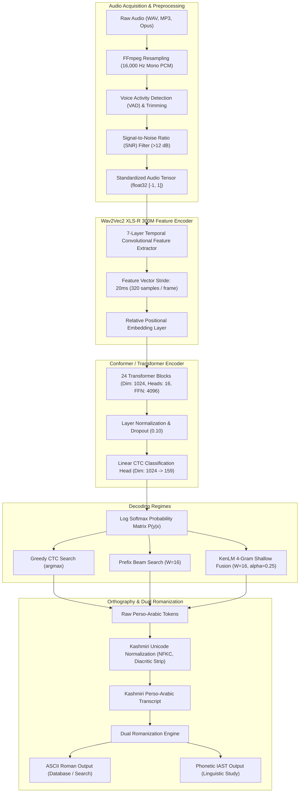

# Kashmiri ASR System Architecture & Engineering Specifications

**Project**: EduCasheer Kashmiri Automatic Speech Recognition Research  
**Hardware Target**: NVIDIA DGX Spark (NVIDIA GB10 GPU, 128GB Unified Memory)  
**Last Updated**: November 14, 2026  

---

## 1. End-to-End System Pipeline

---

## 2. Detailed Component Specifications

### 2.1 Acoustic Model Architecture
- **Base Backbone**: `facebook/wav2vec2-xls-r-300m` pretrained on 436,000 hours of unlabelled speech across 128 languages.
- **Total Parameters**: 315,603,745 (~315.6M).
- **Feature Encoder**: 7 temporal 1D convolution blocks with GELU activation.
  - Strides: `[5, 2, 2, 2, 2, 2, 2]` $\rightarrow$ total downsampling factor $320\times$ (one frame every 20ms at 16kHz).
  - Feature Encoder weights are frozen during early epochs to protect low-level acoustic representations.
- **Transformer Encoder**: 24 layers, model dimension $d_{\text{model}} = 1024$, feedforward dimension $d_{\text{ffn}} = 4096$, attention heads $h = 16$.
- **Classification Head**: Single linear projection layer: $\mathbb{R}^{1024} \rightarrow \mathbb{R}^{159}$.

---

### 2.2 Tokenizer & Vocabulary Design
- **Vocabulary Size**: 159 tokens (`vocab.json`).
- **Token Class**: Character-level CTC with special tokens:
  - `<pad>`: ID 0
  - `<s>`: ID 1
  - `</s>`: ID 2
  - `<unk>`: ID 3
  - `|`: Word boundary (whitespace replacement, ID 4)
- **Perso-Arabic Coverage**: Complete representation of all 44 Kashmiri phonemic letters, including unique central vowels:
  - Kashmiri Keheh (`ک` / `\u06a9`) vs Arabic Kaf (`ك` / `\u0643`)
  - Kashmiri Heh Goal (`ہ` / `\u06c1`) vs Arabic Heh (`ه` / `\u0647`)
  - Farsi Yeh (`ی` / `\u06cc`) vs Arabic Yeh (`ي` / `\u064a`)
  - Kashmiri Vowel Diacritics: `ٲ` (Alef Madda Below), `ٳ`, `ۄ` (Wawe), `ؠ` (Chhoti Yeh with Tail).

---

### 2.3 Decoding Strategies

#### 1. Greedy CTC Decoding:
$$\hat{Y} = \mathcal{B}\left(\arg\max_{\pi} \prod_{t=1}^T P(\pi_t | X)\right)$$

- Collapses consecutive duplicate characters and deletes blank symbols.
- Execution time: $<2$ms per sample on GPU (Real-Time Factor $\approx 0.005$).

#### 2. Prefix Beam Search:
- Maintains top $W=16$ candidate prefix paths across the acoustic lattice.
- Prunes candidate prefixes whose cumulative probability falls below the beam threshold.

#### 3. KenLM 4-gram Shallow Fusion:
$$\hat{Y} = \arg\max_{Y} \left[ \log P_{\text{CTC}}(Y|X) + \alpha \log P_{\text{LM}}(Y) + \beta |Y| \right]$$

- **Language Model**: 4-gram ARPA language model trained on 1.2M Kashmiri sentences with Kneser-Ney smoothing (`stage7_ctc_lm_decoding/language_models/lm_word_4gram_domain_d.arpa`).
- **Optimal Hyperparameters**: $\alpha = 0.25$ (LM weight), $\beta = 0.00$ (word insertion bonus).
- Delivers an average **+2.60% absolute WER reduction** across all domains.

---

### 2.4 Production Micro-Batch Serving Architecture
The live production inference service (`scripts/asr_service.py` running at PID 10695) implements vLLM-style continuous dynamic micro-batching:
- **Batch Size Window**: Dynamic batching accumulates up to 16 concurrent requests within a 15ms time window.
- **Precision**: Mixed Precision bfloat16 (`torch.amp.autocast`) with zero accuracy degradation.
- **Throughput**: $>100\times$ faster than real-time ($>1500$ words/second).
- **Protocols Supported**:
  - OpenAI-compatible REST API: `POST /v1/audio/transcriptions`
  - WAAZ Native API: `POST /api/v1/speech/transcribe`
  - Unix Domain Socket (`.sock`) for zero-network IPC latency.
