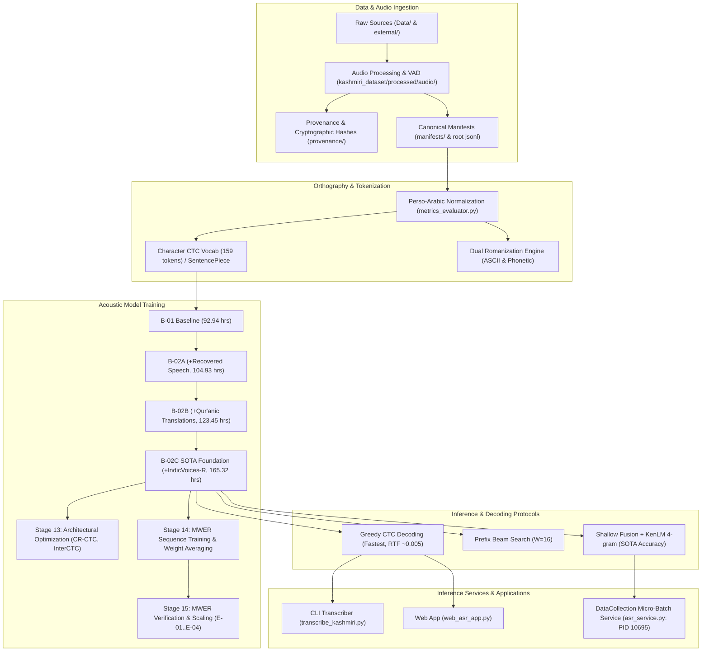

# Project Map & Architectural Navigation Guide

**Project**: EduCasheer Kashmiri Automatic Speech Recognition (ASR) Research Initiative  
**Maintainer**: Principal AI Research Engineer & ML Infrastructure Architect  
**Hardware Environment**: NVIDIA DGX Spark (NVIDIA GB10 GPU, PyTorch 2.14.1+cu130, CUDA 13.0)  
**Root Path**: `/home/musa/Kashmiri Project`  
**Last Audited**: November 14, 2026  

---

## 1. Executive Directory Architecture

The repository is organized into distinct, specialized functional domains designed for long-term maintainability, scientific reproducibility, and backwards compatibility:

```text
/home/musa/Kashmiri Project/
├── docs/                                  # Centralized Project Documentation Hub
│   ├── ARCHITECTURE.md                    # Detailed pipeline, data flow & decoding architecture
│   ├── DATASET_REGISTRY.md                # Comprehensive data sources, manifests & provenance
│   ├── EXPERIMENT_REGISTRY.md             # Complete registry of all training runs & SOTA models
│   ├── PROJECT_MAP.md                     # This file: component map and dependency graph
│   ├── REPRODUCIBILITY.md                 # Verified step-by-step reproduction commands
│   └── SCRIPTS_CATALOG.md                 # Comprehensive catalog of all 154+ scripts
│
├── kashmiri_dataset/                      # Primary Research & Production Workspace
│   ├── documentation/                     # Historical research reports and linguistic guides
│   ├── experiments/                       # All empirical research stages (B-01 through Stage 15)
│   │   ├── asr_baselines/                 # Initial Whisper and baseline benchmarks
│   │   ├── asr_sota_benchmark/            # Baseline models comparison and audits
│   │   ├── benchmark_construction/        # Frozen benchmark datasets (v1, v1.1) and audits
│   │   ├── ceiling_breaker_asr/           # Ensemble and ceiling-breaking configs
│   │   ├── external_asr_benchmark/        # Pretrained external model weights and comparative tests
│   │   ├── native_asr_training/           # Core acoustic model training (B-01, B-02A, B-02B, B-02C)
│   │   │   ├── data_splits/               # 6,728-sample dev and sealed test splits
│   │   │   └── experiments/               # Generation checkpoints (B-01, Stage 9 B-02, Stage 10)
│   │   ├── romanization_benchmark/        # Perso-Arabic to Roman transliteration benchmarks
│   │   ├── romanization_evaluation/       # Romanization accuracy evaluations
│   │   ├── stage11_robustness_optimization/ # Augmentation pilots (reverb, noise, opus)
│   │   ├── stage12_robustness_training/   # Full robustness models (R-01, R-02)
│   │   ├── stage13_architectural_optimization/ # Layer unfreezing (U-01..03), CR-CTC, InterCTC
│   │   ├── stage14_mwer_checkpoint_optimization/ # Minimum Word Error Rate (MWER) & weight averaging
│   │   ├── stage15_mwer_verification_and_scaling/ # Scaled MWER arms (E-01, E-02, E-03, E-04)
│   │   ├── transliteration_evaluation/    # ByT5 and neural adapter transliteration models
│   │   └── unseen_online_data_benchmark/  # Out-of-domain evaluation suite
│   ├── external/                          # Downloaded third-party datasets and raw HuggingFace caches
│   ├── manifests/                         # Canonical manifests across acquisition, QC, and splits
│   │   ├── acquisition/                   # Source acquisition manifests
│   │   ├── deduplication/                 # Cross-corpus duplicate cluster maps
│   │   ├── quality_control/               # SNR and VAD audio quality manifests
│   │   ├── source_manifests/              # Per-dataset source manifests (Bolbosh, IndicVoices, etc.)
│   │   └── training/                      # Training eligibility manifests
│   ├── models/                            # Extracted model weights, checkpoints, NeMo exports
│   ├── processed/                         # Standardized 16kHz mono PCM WAV speech audio
│   │   └── audio/                         # Organized by source (openslr122, bolbosh, indicvoices, etc.)
│   ├── provenance/                        # Cryptographic SHA-256 provenance registries (JSON & CSV)
│   ├── quality_reports/                   # Audio coverage and SNR statistical audits
│   ├── raw/                               # Raw archives and original download shards
│   ├── reports/                           # Workstream reports and forensic analysis
│   ├── research_log/                      # Sequential research logs (Workstreams 1 through 14)
│   ├── scripts/                           # Python and Bash scripts (154 scripts)
│   │   ├── dataset_acquisition/           # Specialized data harvesting and QC pipeline
│   │   └── SCRIPTS_CATALOG.md             # Categorized catalog of scripts
│   ├── splits/                            # Initial train/val/test split definitions
│   ├── tokenizers/                        # SentencePiece models (8k-32k) and HuggingFace CTC vocabularies
│   └── user_recordings/                   # Live microphone test recordings
│
├── Data/                                  # Uncompressed Raw Source Data Shards (Read-Only)
│   └── Kashmiri Project-20261101T102755Z-1-001..022/ # Modalities (Speech, OCR, Text)
│
├── paper/                                 # Academic Research Manuscript Drafts
│   └── kashmiri_asr_research_paper.md     # Primary research manuscript
│
├── papers/                                # Curated Reference Literature Library
│   ├── download_papers.py                 # Automated literature fetcher
│   └── ...                                # 25 seminal research PDFs
│
├── reading/                               # Theoretical Foundations & Tokenization Handbooks
│   └── MASTER_TOKENIZATION_HANDBOOK.md    # Guide to low-resource orthography & subwords
│
├── research/                              # Master Multi-Modal AI Roadmap (Speech, LLM, OCR)
│   └── 00_MASTER_INDEX_AND_EXECUTIVE_SUMMARY.md
│
├── researh                                # Backward-compatibility symlink -> research
│
├── Root Operational & Demo Entry Points:
│   ├── transcribe_kashmiri.py             # Primary CLI inference utility (Auto-loads SOTA B-02C)
│   ├── test_batch_transcribe.py           # Smoke test script for fast validation
│   ├── web_asr_app.py                     # Browser-based recording and transcription UI
│   ├── record_and_transcribe.sh           # Terminal interactive microphone recorder + transcriber
│   └── run_training_terminal.sh           # Safe terminal training launcher
│
├── Root Backward-Compatibility Manifests & Evaluation Artifacts:
│   ├── asr_training_eligible_manifest.jsonl # 106,487 training-eligible samples (214.65 hrs)
│   ├── download_manifest.jsonl            # 25,860 raw acquisition audio targets
│   ├── new_unique_kashmiri_samples.jsonl  # 25,860 deduplicated speech samples
│   ├── b01_corrected_test_predictions.jsonl # B-01 held-out test predictions
│   ├── b02a_followup_test_predictions.jsonl # B-02A held-out test predictions
│   ├── b02a_followup_test_report.md       # B-02A vs B-01 heldout evaluation report
│   ├── matched_decoder_test_comparison.csv # 3-way decoder comparison table
│   ├── paired_test_bootstrap.json         # 10,000 bootstrap resamples on test split
│   ├── sourcewise_test_results.csv        # Source-wise domain breakdown on test split
│   └── QURAN_*                            # Workstream 9 Qur'anic dataset reports & candidate pools
│
├── README.md                              # Main Project Entry Point & Architecture
├── PROJECT_MAP.md                         # Top-level symlink -> docs/PROJECT_MAP.md
├── EXPERIMENT_REGISTRY.md                 # Top-level symlink -> docs/EXPERIMENT_REGISTRY.md
├── DATASET_REGISTRY.md                    # Top-level symlink -> docs/DATASET_REGISTRY.md
└── REPRODUCIBILITY.md                     # Top-level symlink -> docs/REPRODUCIBILITY.md
```

---

## 2. High-Level Dependency Graph



---

## 3. Directory Responsibilities and Navigation

### 3.1 `kashmiri_dataset/experiments/`
Contains the complete scientific timeline of ASR experiments:
- **`native_asr_training/`**: The foundation series.
  - `B-01-xlsr300m-character-ctc/`: The initial 92.94h baseline model (`best_model/`).
  - `stage9_b02_acoustic_comparison/`: The landmark acoustic study comparing:
    - `B-01_baseline_evaluation/`: Evaluated on standard 6,728 dev samples.
    - `B-02A/`: Added 11.99 hours of recovered speech. Checkpoint: `checkpoints/best_model` (Epoch 19).
    - `B-02B/`: Added 20.91 hours of Qur'anic speech. Checkpoint: `checkpoints/best_model` (Epoch 20).
    - `B-02C/`: Added 41.87 hours of IndicVoices-R. Checkpoint: `checkpoints/best_model` (Epoch 20). **Best acoustic foundation.**
    - `b02a_followup_heldout_evaluation/`: Strict evaluation on the sealed held-out test split.
- **`stage11_robustness_optimization/`**: Acoustic stress-testing with synthetic room impulse responses (reverb), environmental noise, and Opus codec degradation.
- **`stage12_robustness_training/`**: Production-scale robustness fine-tuning (`R-01_reverb_full`, `R-02_combined_full`).
- **`stage13_architectural_optimization/`**: Layer unfreezing investigations (`U-01`, `U-02`, `U-03`), Consistency Regularized CTC (`CR-01`), and Intermediate CTC (`I-01`).
- **`stage14_mwer_checkpoint_optimization/`**: Direct sequence minimum word error rate loss formulation and temporal weight averaging (`WA-01`, `WA-02`, `WA-03`).
- **`stage15_mwer_verification_and_scaling/`**: Rigorous scaling and sourcewise parity testing for MWER (`E-01` through `E-04`).

### 3.2 `kashmiri_dataset/manifests/`
Single source of truth for audio files and transcript pairings:
- `train.jsonl` / `train.csv`: Master 7,307-sample training set (Stage 1-5).
- `val.jsonl` / `val.csv`: 945-sample development set.
- `test.jsonl` / `test.csv`: 928-sample sealed test benchmark.
- `test_clean.jsonl`, `test_noisy.jsonl`, `test_code_switched.jsonl`, `test_speaker_unseen.jsonl`: Specialized diagnostic evaluation partitions.
- `training/asr_training_eligible_manifest.jsonl`: Comprehensive 106,487-utterance manifest (214.65 hours).

### 3.3 `kashmiri_dataset/processed/audio/`
All audio is standardized to uniform audio characteristics:
- **Encoding**: 16-bit Linear PCM (`.wav`)
- **Sampling Rate**: 16,000 Hz
- **Channels**: 1 (Mono)
- **Subdirectories**: `bolbosh/`, `indicvoices_kashmiri/`, `indicvoices_r/`, `openslr122/`, `ktts/`, `xkaab/`, `quran_mirwaiz/`, `quran_dr_war/`, `whisper_kashmiri/`.

### 3.4 `kashmiri_dataset/scripts/`
Contains 154 standalone utilities, categorized in `docs/SCRIPTS_CATALOG.md`. Key scripts include:
- `train_stage9_full_schedule.py`: Complete multi-epoch training pipeline for B-02A/B/C.
- `evaluate_stage9_decoders.py`: Multi-decoder evaluation engine (Greedy, Beam Search, KenLM).
- `metrics_evaluator.py`: Canonical Levenshtein WER/CER computation and Perso-Arabic normalizer.
- `kashmiri_transliteration_engine.py`: High-throughput rule-based Romanization engine.

---

## 4. External Dependencies and Live Services

### Active Runtime Service
- **Process**: `scripts/asr_service.py` (PID 10695) running from `/home/musa/Desktop/Projects/DataCollection`
- **Port**: TCP `8026` + UDS `/home/musa/Desktop/Projects/DataCollection/data/asr_service.sock`
- **Dependencies in Kashmiri Project**:
  - `kashmiri_dataset/scripts/kashmiri_transliteration_engine.py`
  - `kashmiri_dataset/experiments/native_asr_training/experiments/stage9_b02_acoustic_comparison/B-02C/checkpoints/best_model`
  - `kashmiri_dataset/experiments/native_asr_training/data_splits/val.jsonl`
- **Status**: Live and serving real-time requests. Never delete, relocate, or disrupt these paths.
