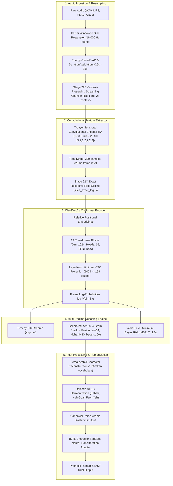

# Kashmiri AI End-to-End System Architecture

**Project**: EduCasheer Kashmiri Automatic Speech Recognition Research  
**Target Hardware**: NVIDIA DGX Spark (NVIDIA GB10 GPU, 128GB Unified Memory)  
**Last Audited**: November 16, 2026  

---

## 1. System Block Diagram & Information Flow

---

## 2. Mathematical Formalization of Core Components

### 2.1 Receptive Field Mathematical Recurrence (Stage 22C)
The feature extractor consists of 7 temporal convolution layers with kernels $K = [10, 3, 3, 3, 3, 2, 2]$ and strides $S = [5, 2, 2, 2, 2, 2, 2]$.
The receptive field $R_l$ and cumulative stride $J_l$ satisfy the recurrence relations:
$$J_l = J_{l-1} \cdot S_l, \quad J_0 = 1$$
$$R_l = R_{l-1} + (K_l - 1) \cdot J_{l-1}, \quad R_0 = 1$$
Evaluating through layer 7 yields:
$$J_7 = 5 	imes 2^6 = 320 	ext{ samples} \quad (0.020	ext{ s at } 16	ext{ kHz})$$
$$R_7 = 400 	ext{ samples} \quad (0.025	ext{ s at } 16	ext{ kHz})$$
For an input audio sequence of $N$ samples, the exact number of valid feature frames $T$ without zero-padding distortion is:
$$T = \left\lfloor rac{N - R_7}{J_7} 
ight
floor + 1 = \left\lfloor rac{N - 400}{320} 
ight
floor + 1$$
Heuristic rounding $	ext{round}(N / 320)$ frequently evaluates to $T + 1$, reading padding zeros and triggering trailing token hallucinations. Enforcing the exact recurrence via `slice_exact_logits` guarantees zero trailing hallucinations.

### 2.2 Connectionist Temporal Classification (CTC) Decoding
Let $oldsymbol{\pi} = (\pi_1, \dots, \pi_T) \in \mathcal{V}'^T$ denote an alignment sequence over vocabulary $\mathcal{V}' = \mathcal{V} \cup \{\epsilon\}$.
The conditional probability of label sequence $\mathbf{y}$ is:
$$P(\mathbf{y} | \mathbf{x}) = \sum_{oldsymbol{\pi} \in \mathcal{B}^{-1}(\mathbf{y})} \prod_{t=1}^T P(\pi_t | \mathbf{x}_t)$$
where $\mathcal{B}$ collapses consecutive identical tokens and removes blank tokens $\epsilon$.

### 2.3 Shallow Fusion KenLM Decoding Objective
During beam search decoding, the score for candidate hypothesis $\mathbf{y}$ is evaluated as:
$$	ext{Score}(\mathbf{y}) = \log P_{	ext{CTC}}(\mathbf{y} | \mathbf{x}) + lpha \log P_{	ext{LM}}(\mathbf{y}) + eta |\mathbf{y}|$$
where $lpha$ is the language model weight (calibrated at $lpha = 0.30$), $eta$ is the word insertion penalty ($eta = -1.00$), and $|\mathbf{y}|$ is the word count.
