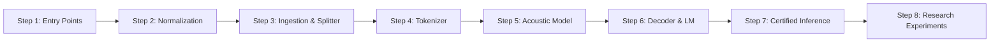

# Kashmiri AI Codebase Optimal Reading Guide

**Target Audience**: Principal AI Researchers, ML Infrastructure Engineers, Reproducibility Auditors  
**Objective**: Progressive, dependency-aware reading sequence to understand the entire software architecture in minimum time without getting lost in historical scripts.

---

## 1. Recommended Study Sequence at a Glance

---

## 2. Step-by-Step Code Walkthrough

### Step 1: High-Level Operational Entry Points
Begin with the production inference interfaces to understand user-facing behavior:
1. **`transcribe_kashmiri.py`** (Lines 1–105)
   - *Why*: Primary command-line transcription utility. Demonstrates model checkpoint loading, audio resampling to 16kHz, BF16 AMP inference, and text normalization.
   - *Key Class*: `KashmiriASR`
   - *Prerequisite*: Basic PyTorch and HuggingFace Transformers knowledge.
2. **`test_batch_transcribe.py`**
   - *Why*: Fast 3-sample smoke test reading from canonical `val.jsonl`.
3. **`web_asr_app.py`**
   - *Why*: Browser-based microphone recording and transcription GUI with real-time Romanization.

### Step 2: Kashmiri Orthography & Text Harmonization
Understand the linguistic foundations and Unicode normalization:
1. **`kashmiri_dataset/scripts/normalize_transcripts.py`**
   - *Why*: The linguistic backbone of the entire project. Converts Arabic Keheh/Heh/Yeh variants to canonical Kashmiri forms and handles central vowels.
   - *Key Function*: `normalize_kashmiri_text(text: str) -> str`
2. **`reading/MASTER_TOKENIZATION_HANDBOOK.md`**
   - *Why*: Comprehensive theoretical foundation explaining why subwords fail and characters succeed on morphologically rich Kashmiri.

### Step 3: Dataset Ingestion, Quality Gates & Split Isolation
Understand how raw audio is processed and partitioned:
1. **`kashmiri_dataset/scripts/pretraining_validation_gates.py`**
   - *Why*: Implements the 5 validation gates (Format, Duration, CTC Feasibility, SNR/VAD, Orthography).
2. **`kashmiri_dataset/scripts/create_splits.py`**
   - *Why*: Enforces strict zero-speaker overlap between training and validation sets.
3. **`kashmiri_dataset/scripts/audit_speech_corpus_quality.py`**
   - *Why*: Audits signal-to-noise ratio, clipping, and silence across 106k audio files.

### Step 4: Tokenizer & Language Model Construction
Understand vocabulary encoding and statistical LM decoding:
1. **`kashmiri_dataset/scripts/train_and_evaluate_tokenizers.py`**
   - *Why*: Trains and benchmarks SentencePiece vs Character CTC tokenizers; proves 0.000% OOV for 159 characters.
2. **`kashmiri_dataset/scripts/train_kashmiri_language_models.py`**
   - *Why*: Trains 4-gram KenLM language models with modified Kneser-Ney smoothing on 1.2M Kashmiri sentences.

### Step 5: Foundation Acoustic Model Training
Understand how Wav2Vec2 XLS-R 300M is trained on GPU:
1. **`kashmiri_dataset/scripts/train_b01_full_schedule.py`**
   - *Why*: Canonical training loop implementation with AdamW, linear warmup/decay, BF16 AMP, and dynamic batching.
2. **`kashmiri_dataset/experiments/stage22_data_expanded_training/`**
   - *Why*: Active implementation of the Stage 22 data expansion campaign producing Champion `E22-01`.

### Step 6: Decoder Optimization & CTC Mathematical Guarantees
Understand exact CTC slicing and search headroom:
1. **`kashmiri_dataset/experiments/stage22c_inference_certification/inference/stage22c_exact_output_lengths.py`**
   - *Why*: Proves the 7-layer CNN receptive field mathematical recurrence and implements `slice_exact_logits` to kill trailing token hallucinations.
2. **`kashmiri_dataset/experiments/stage22c_inference_certification/chunking/evaluate_dev_chunking_strategies.py`**
   - *Why*: Implements Method C2 streaming chunker, preventing 1.5TB attention OOM on long audio.

### Step 7: Research Experiments & Negative Results
Understand the frontier research and what did NOT work:
1. **`kashmiri_dataset/experiments/stage20r_integrity_audit/`**
   - *Why*: The forensic audit that discovered the 22.05 kHz resampling bug and eliminated 493 phantom errors.
2. **`kashmiri_dataset/experiments/stage24_actual_reranker_training/train_stage24_reranker.py`**
   - *Why*: Full GPU training of candidate rerankers and decisive empirical proof that KenLM shallow fusion remains optimal.
