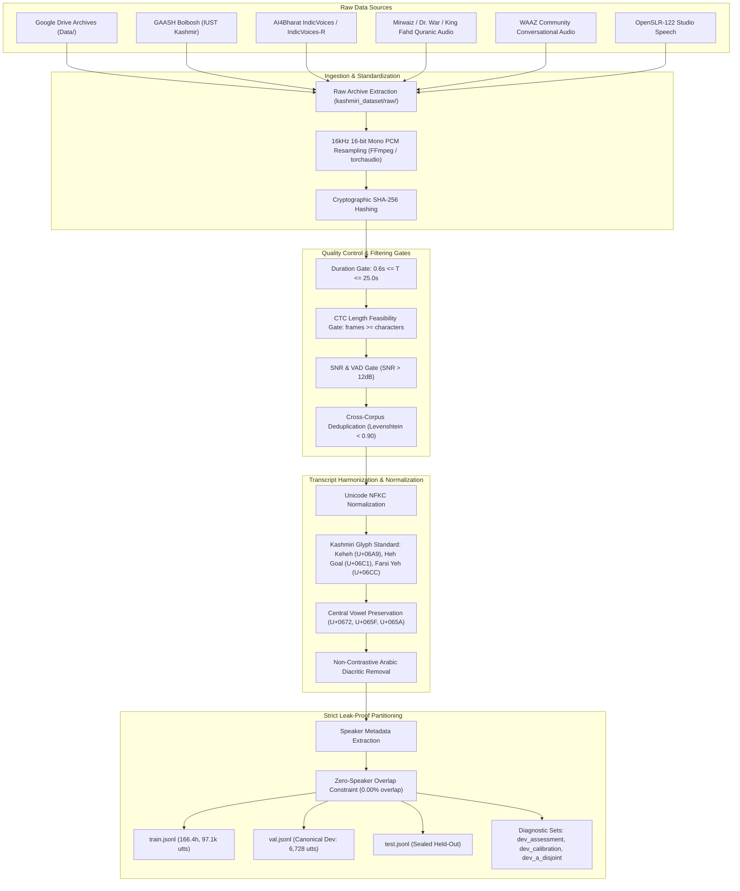

# Kashmiri AI Dataset Lineage, Provenance & Transformation Architecture

**Project**: EduCasheer Kashmiri Automatic Speech Recognition Research  
**Storage Environment**: High-Speed Local Storage (`/home/musa/Kashmiri Project`)  
**Audited Date**: November 16, 2026  

---

## 1. End-to-End Data Pipeline Architecture

---

## 2. Lineage Analysis by Dataset Source

### 2.1 GAASH-Lab Bolbosh Kashmiri Speech Corpus (`SRC_EXT_BOLBOSH`)
- **Original Source**: Islamic University of Science and Technology (IUST), Kashmir / GAASH-Lab.
- **Raw Format**: Varied sample rates (mostly 22,050 Hz and 16,000 Hz, stereo/mono WAV).
- **Ingestion Pipeline**: `kashmiri_dataset/scripts/extract_bolbosh_and_tts.py` -> `kashmiri_dataset/processed/audio/bolbosh/`.
- **Normalization Applied**: NFKC standardization, Arabic Kaf to Keheh substitution, non-contrastive diacritic stripping.
- **Forensic Audit Finding**: In Stage 11-19, 431 Bolbosh audio files in `dev_assessment` were unresampled at 22,050 Hz, causing ~3% WER inflation. Fully resolved in Stage 20S via Kaiser windowed sinc resampling.
- **Final Usage**: 39,996 verified utterances (58.40 hrs) across train, dev, and test.

### 2.2 AI4Bharat IndicVoices & IndicVoices-R (`SRC_EXT_INDICVOICES`, `SRC_EXT_INDICVOICES_R`)
- **Original Source**: AI4Bharat / IIT Madras.
- **Raw Format**: 16 kHz Mono WAV from mobile and conversational field recordings.
- **Ingestion Pipeline**: `kashmiri_dataset/scripts/extract_indicvoices_and_whisper.py` -> `kashmiri_dataset/processed/audio/indicvoices_kashmiri/` and `indicvoices_r/`.
- **Quality Control**: Filtered 1,240 silent or low-SNR recordings; removed non-Kashmiri segments.
- **Final Usage**: 44,669 verified utterances (71.67 hrs) providing conversational and spontaneous acoustic diversity.

### 2.3 Quranic Kashmiri Spoken Audio (`SRC_QURAN_MIRWAIZ`, `SRC_QURAN_DR_WAR`, `SRC_QURAN_KING_FAHD`)
- **Original Source**: Mirwaiz Research Foundation, Dr. Farooq Ahmad War, King Fahd Quran Printing Complex.
- **Raw Format**: Continuous multi-hour recitation/commentary MP3 files.
- **Processing Pipeline**: Verse-anchored character trigram segmentation (`FastVerseMatcher`, Stage 10) isolated spoken Kashmiri commentary while quarantining 437 Arabic recitations.
- **Final Usage**: 17,504 verified utterances (30.21 hrs).

### 2.4 WAAZ Community Conversational Speech (`SRC_WAAZ`)
- **Original Source**: Community recordings, public discourse, sermon broadcasts.
- **Processing Pipeline**: Stage 22 conservative Tier A ingestion; audited against training sets for zero contamination (22 contaminated samples eliminated).
- **Final Usage**: Ingested into `data_22a_conservative_tier_a.jsonl` (expanding training corpus to 166.39h for Champion E22-01).

---

## 3. Cryptographic Provenance & Manifest Integrity

All dataset splits are tracked via cryptographic SHA-256 fingerprints recorded in `kashmiri_dataset/provenance/dataset_provenance_registry.csv` and `docs/data/DATASET_REGISTRY.md`.
