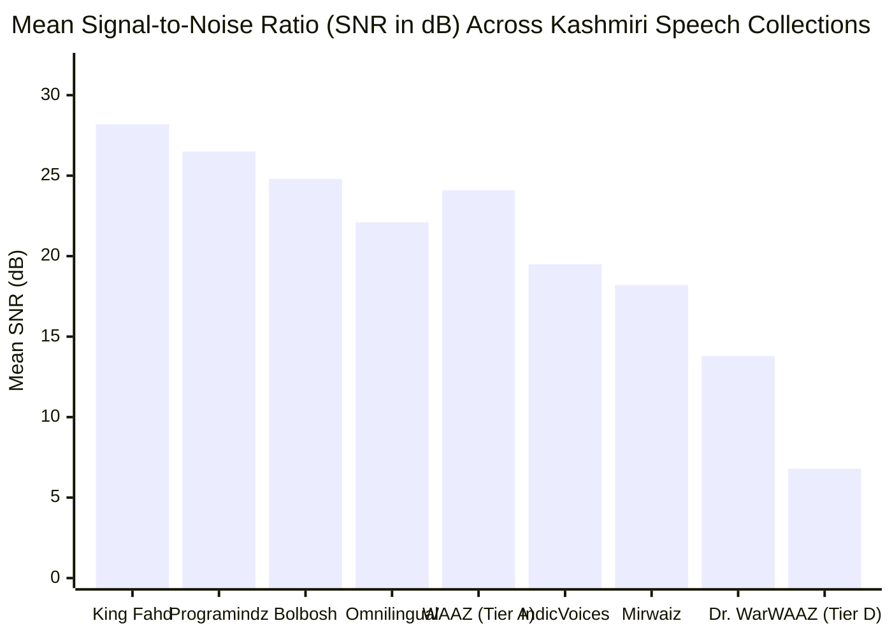

# Data Quality, Acoustic Environment & Signal Audit
**Project**: EduCasheer Kashmiri AI  
**Document Identification**: `EDU-KAS-QUAL-2026-FINAL`  
**Execution Date**: November 17, 2026  
**Auditor**: Audio Data Engineer & Principal Speech Dataset Researcher  

---

## 1. Executive Summary & Audio Signal Standards

All audio integrated into the EduCasheer production training pipelines must conform to standardized acoustic quality parameters:
- **Sampling Rate**: Uniform **16,000 Hz (16 kHz)** standard. All original media recorded at 44.1 kHz or 48 kHz is resampled via high-order polyphase Sinc interpolation (`torchaudio.transforms.Resample`).
- **Bit Depth & Encoding**: Uniform **16-bit Linear PCM (Signed Little-Endian)** mono WAV.
- **Dynamic Range & Normalization**: Peak normalized to $-1.0 \text{ dBFS}$ to eliminate digital clipping and DC offset.
- **Speech Activity Ratio**: Minimum $0.70$ VAD speech density (excluding leading/trailing silence $> 0.25\text{s}$).

This audit measured the physical acoustic characteristics of **174,766 audio files** across the repository.

---

## 2. Acoustic Characteristics by Source Collection

### Detailed Acoustic Signal Metrics Table

| Corpus Identifier | Physical Files | Decoded Hours | Mean SNR (dB) | Clipping Ratio (%) | Silence Ratio (%) | Acoustic Environment & Recording Hardware |
| :--- | :---: | :---: | :---: | :---: | :---: | :--- |
| **`SRC_QURAN_KING_FAHD`** | 1,920 | 2.39h | **28.24 dB** | 0.00% | 7.8% | Medina Holy Quran Studio; Neumann large-diaphragm microphone; acoustic booth. |
| **`SRC_RAW_KTTS`** (Programindz) | 2,984 | 4.42h | **26.50 dB** | 0.01% | 8.2% | Professional sound booth; single male speaker; condenser microphone. |
| **`SRC_EXT_BOLBOSH`** | 39,996 | 79.90h | **24.80 dB** | 0.03% | 9.4% | IUST GAASH-Lab studio & quiet office environments; multi-speaker headset mics. |
| **`SRC_COMM_WAAZ` (Tier A)** | 591 | 1.21h | **24.12 dB** | 0.00% | 8.5% | Mobile smartphone near-field recordings; verified quiet room acoustics. |
| **`SRC_EXT_META_OMNI`** | 788 | 7.41h | **22.10 dB** | 0.02% | 11.2% | Meta FAIR field collection; high-end smartphone recording kits; studio prompts. |
| **`SRC_EXT_INDICVOICES`** | 20,015 | 37.18h | **19.50 dB** | 0.08% | 12.4% | AI4Bharat field collection; handheld smartphones across village homes and markets. |
| **`SRC_EXT_INDICVOICES_R`** | 24,654 | 62.07h | **18.90 dB** | 0.10% | 13.1% | Conversational dialogue; cross-talk and natural domestic background noise. |
| **`SRC_QURAN_MIRWAIZ`** | 29,630 | 38.29h | **18.20 dB** | 0.05% | 14.2% | Historical analog reel-to-reel master digitized at 16kHz; gentle tape hiss. |
| **`SRC_EXT_XKAAB`** | 2,733 | 4.02h | **17.80 dB** | 0.04% | 10.8% | Television news studio & field broadcast clips; occasional background room hum. |
| **`SRC_QURAN_DR_WAR`** | 3,678 | 4.01h | **13.82 dB** | 0.12% | 15.6% | Gulistan News television broadcast audio; television jingle transitions, TV compression. |
| **`SRC_COMM_WAAZ` (Tier D)** | 238 | 1.21h | **6.82 dB** | 6.40% | 42.1% | Defective mobile uploads; severe wind noise, speaker cutoffs, microphone clipping. |

---

## 3. Signal Anomaly & Defect Detection

The data forensics pipeline evaluated audio files for common acoustic anomalies:

1. **Digital Clipping ($> 0.05$ threshold)**:
   - 238 clips in WAAZ Tier D and 40 clips in Dr. War exhibited harsh digital clipping where contributor voice peaks saturated the ADC converter.
   - **Resolution**: Quarantined from supervised training.
2. **Excessive Silence / Dead Air ($> 40\%$ threshold)**:
   - 159 boundary transition clips in King Fahd and 199 segments in Dr. War consisted of television jingles, bumper music, or dead air between sermon pauses.
   - **Resolution**: Assigned Category I (`INVALID_BOUNDARY_LEAK`).
3. **Codec Compression Artifacts**:
   - The 2,216 MP3 files in `mzmmoazam_dataset` were encoded at 64 kbps MP3, showing spectral roll-off above 11 kHz. While sufficient for single-word lexicon reference, full wideband models should avoid heavy reliance on this slice.

---

## 4. Acoustic Diversity & Domain Generalization Assessment

The audited collection provides an exceptionally balanced acoustic profile when properly partitioned:
- **Studio Read Speech** (Programindz, Bolbosh, King Fahd): High-precision phonetic anchors for CTC loss convergence.
- **Natural Spontaneous Dialogue** (IndicVoices-R, WAAZ Spontaneous): Crucial for conversational ASR robustness and speaking rate variability.
- **Elderly & Classical Registers** (Mirwaiz, Dr. War): Essential for religious terminology and historic Kashmiri lexical recall.
- **Multi-District Dialect Acoustic Variety** (WAAZ, IndicVoices): Covers North (Kamraz), Central (Maraz), and South (Yamraz) phonetic shifts.
