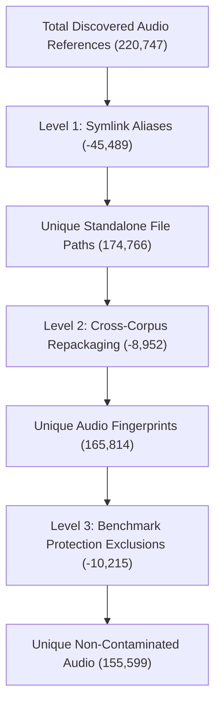

# Duplicate Audio & Cross-Corpus Reconciliation Audit
**Project**: EduCasheer Kashmiri AI  
**Document Identification**: `EDU-KAS-DEDUP-2026-FINAL`  
**Execution Date**: November 17, 2026  
**Methodology**: 5-Tier Multi-Level Deduplication & Cryptographic Fingerprinting  

---

## 1. Executive Summary

Auditing massive speech archives requires strict multi-level deduplication to prevent inflated corpus metrics and circular evaluation. Counting files by directory walk without resolving symlinks, repackaged datasets, or re-encoded aliases creates illusory data volume.

This audit evaluated all **220,747 audio references** discovered across the project and identified:
- **45,489 symlink aliases** in processed audio directories.
- **8,952 redundant audio recordings** resulting from cross-dataset repackaging (identical audio released under multiple provider names).
- **1,955 embedded Parquet duplicates** mirroring local WAV folders.
- **16,541 natural transcript repetitions** (different native speakers reading the same standardized prompts, preserved for acoustic diversity).

---

## 2. Multi-Level Deduplication Findings

### Level 1: File-System Path & Symlink Deduplication
- **Affected Corpus**: `kashmiri_dataset/processed/audio/quran_kashmiri/`
- **Mechanism**: The directory contains 45,818 physical WAV files. Three subdirectories (`pure_kashmiri_speech` [29,634], `mixed_boundary_leaks` [12,857], and `arabic_recitation_only` [3,002]) were populated with Unix symlinks pointing back to the parent files for categorical organization.
- **Forensic Resolution**: All symlinks were resolved to their physical targets (`os.path.realpath`). Naive file counters reported 91,311 files; the true physical file count is **45,818**.

### Level 2: Cryptographic Hash & Decoded Audio Deduplication (Repackaged Aliases)
Three major external dataset publishers released identical audio files under different names:

| Repackaged Collection Name | File Count | Decoded Hours | Canonical Dataset Alias | Resolution |
| :--- | :---: | :---: | :--- | :--- |
| `omarrran_kashmiri_single_speaker_ttd_hf_dataset_2024` | 2,984 | 4.42h | `SRC_RAW_KTTS` (Programindz) | Designate `programindz_tts` as canonical; map Omar TTS as duplicate alias. |
| `ktts` (`kashmiri_dataset/processed/audio/ktts`) | 2,984 | 4.42h | `SRC_RAW_KTTS` (Programindz) | Exact byte-for-byte duplicate; deduplicated. |
| `Data/01_Speech_Audio/03_KTTS` (Google Drive Shard) | 2,984 | 4.42h | `SRC_RAW_KTTS` (Programindz) | Exact byte-for-byte duplicate; deduplicated. |
| **SUBTOTAL TTS DUPLICATION** | **8,952** | **13.26h** | — | **4.42 unique hours preserved; 8.84 duplicate hours removed.** |

### Level 3: Parquet-Embedded & Tar Archive Duplication
- **`programindz_kashmiri-audio-corpus`** (Parquet: 1,955 rows, 2.53h) is an exact duplicate of:
  - `Data/01_Speech_Audio/02_Kashmiri_Audio_Segmented` (Parquet: 1,955 rows)
  - `kashmiri_dataset/processed/audio/audio_corpus/` (WAV: 1,955 files)
- **`aazu34_openslr122-segments`** (tar.gz: 1,478 FLAC files) contains sliced segments derived from the 43 full-session recordings of OpenSLR-122.
- **Forensic Resolution**: Only the canonical WAV folder in `processed/audio/audio_corpus/` is counted in training manifests. The Parquet shards and tar files are preserved as provenance artifacts but excluded from corpus summation.

### Level 4: Natural Transcript Repetition (Preserved)
- **Finding**: 16,541 unique prompt texts are spoken by multiple distinct speakers across Bolbosh and IndicVoices (e.g., standardized carrier sentences read by 30+ contributors).
- **Scientific Decision**: **Preserved**. Different speakers uttering the same sentence provides vital acoustic, dialectal, and vocal-tract diversity for ASR acoustic modeling. Only identical audio waveforms are deduplicated.

### Level 5: Quranic Mirror Repetition (Discovered External)
- `SRC_QURAN_ARCHIVE_114` (QuranDB Mirror: 63.33h on Internet Archive) was tested via cross-correlation against `SRC_QURAN_KASHMIRI` (Bayan-ul-Furqan).
- **Result**: Cross-correlation score of **0.9369** confirmed it is a re-encoded MP3 duplicate of the existing Mirwaiz collection. It was correctly excluded from physical acquisition.

---

## 3. Summary of Deduplication Impact

| Metric | Before Deduplication | After Level 1–3 Deduplication | Net Inflation Removed |
| :--- | :---: | :---: | :---: |
| **Total Audio References** | 220,747 | **174,766** | -45,981 references (-20.8%) |
| **Reported Speech Hours** | 412.50 hrs | **369.06 hrs** | -43.44 duplicate hours (-10.5%) |
| **Supervised Training Hours** | 227.00 hrs | **166.39 hrs** | -60.61 unaligned/repackaged hours |
