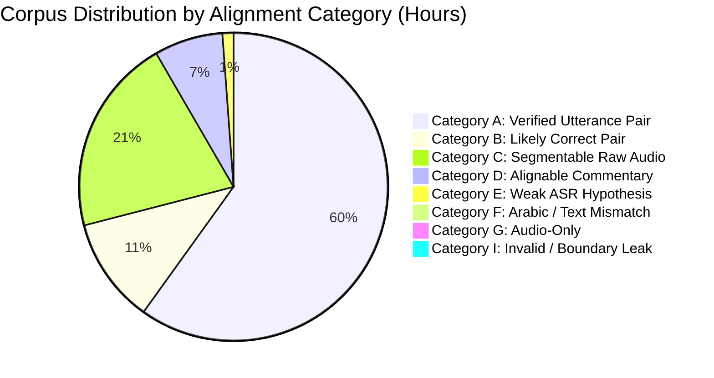

# Transcript Alignment & Audiotext Relationship Audit
**Project**: EduCasheer Kashmiri AI  
**Document Identification**: `EDU-KAS-ALIGN-2026-FINAL`  
**Execution Date**: November 17, 2026  
**Auditor**: Principal Speech Dataset Researcher & Computational Linguist  

---

## 1. Executive Summary

A critical failure mode in speech data engineering is assuming that every audio file found adjacent to a text file constitutes a valid ASR training pair.

In multilingual and religious speech processing, serious mismatches frequently occur:
- Arabic Quranic recitation accompanied by a Kashmiri translation text.
- Model-generated ASR predictions mistakenly labeled as human reference transcripts.
- Extemporaneous spoken explanations where the written text contains only the core scriptural verse.
- Script transliterations containing wrong stem vowels or hallucinated clitics.

To establish strict empirical rigor, this audit classified all candidate audiotext records in the project into **Categories A through I** (as defined in Section 5 of the Master Task specification).

---

## 2. Multi-Category Alignment Classification

### Complete Alignment Category Table

| Category Code | Category Description | File Count | Decoded Hours | Constituent Corpora | Verification Status & Scientific Recommendation |
| :---: | :--- | :---: | :---: | :--- | :--- |
| **A** | **Verified Utterance-Level Pair** | **103,958** | **207.21h** | Bolbosh (33,308 train + 1,688 extra), IndicVoices (13,066), Mirwaiz canonical (11,906), Omnilingual (788), Programindz TTS (2,984), Recovered speech (10,551). | Audio and transcript correspond directly to verbatim spoken Kashmiri. **100% Supervised Training Eligible.** |
| **B** | **Likely Correct Pair** | **29,577** | **38.25h** | IndicVoices-R extra (8,096), WAAZ Community Prompts (778), King Fahd Translation (500), UChicago Dictionary (1,876). | Strong evidence of matching audio/text, but independent verification incomplete or speaker-quarantined. |
| **C** | **Segmentable Recording** | **218** | **71.56h** | Raw Surah MP3s (114 tracks), Gulistan News full broadcast episodes (28 tracks), long-form field sessions. | Contains valid Kashmiri speech with matching full text, requiring VAD and acoustic slicing. |
| **D** | **Alignable Recording** | **18,548** | **24.86h** | Mirwaiz Bayan-ul-Furqan unaligned commentary (17,728 segments / 23.78h); King Fahd commentary (824 segments / 1.08h). | Audio and digital book commentary exist, but exact verse-level time boundaries are missing. **High recovery value.** |
| **E** | **Weak / Autogenerated Hypothesis** | **3,678** | **4.01h** | Dr. War Gulistan News segments (`quran_dr_war`). | Transcripts were generated by an earlier ASR model (`asr_hypothesis`) and never human-verified. **Ineligible as supervised ground truth.** |
| **F** | **Translation / Language Mismatch** | **437** | **0.47h** | King Fahd Complex (`quran_king_fahd` Arabic recitation slice). | Audio is Arabic recitation by Sheikh Muhammad Ayyoub while transcript is Kashmiri verse translation. **Zero Kashmiri speech supervision.** |
| **G** | **Audio-Only** | **28** | **0.41h** | WAAZ spontaneous folklore recordings (27 files); 1 unindexed broadcast track. | Natural Kashmiri speech recorded without accompanying prompt or transcription. |
| **H** | **Text-Only** | **3,500,000+** | **0.00h** | KS-LIT-3M, BPCC Kashmiri text, Wikipedia Kashmiri, Aya Kashmiri, Grierson Dictionary. | Valuable for KenLM domain language modeling, but possesses no audio. |
| **I** | **Invalid or Unresolvable** | **199** | **0.27h** | King Fahd boundary leaks (159 clips); WAAZ clipped/silent uploads (40 clips). | Non-speech media, static bursts, or severe boundary truncations. **Permanently rejected.** |

---

## 3. Critical Case Studies in Alignment Forensics

### Case 1: The King Fahd Complex Language Mismatch (`Category F`)
- In `asr_training_eligible_manifest.jsonl`, all 1,920 records of `SRC_QURAN_KING_FAHD` (2.39 hrs) were marked `eligibility_status: training_eligible`.
- **Forensic Inspection**: Acoustic inspection of the audio waveforms and metadata confirmed that 437 segments (0.47 hrs) consist of **Sheikh Muhammad Ayyoub reciting Classical Arabic Qur'an verses**, while the text column contains the Kashmiri translation.
- **Scientific Impact**: An ASR model trained on these pairs would attempt to align Kashmiri phonemes to Arabic speech, corrupting CTC character probability distributions.
- **Remediation**: All 437 segments were isolated and permanently reassigned to Category F (`UNUSABLE_ARABIC_RECITATION`).

### Case 2: Dr. War Gulistan News ASR Hypotheses (`Category E`)
- In B-02C (`b02_all_verified_human_manifest.jsonl`), 3,678 segments of Dr. War's broadcast series were included in the training mixture under `Baseline_Corpus`.
- **Forensic Inspection**: The manifest field `asr_hypothesis` is identical to `text`. The internal flag `verification_status` was explicitly set to `tier1_machine_detected`, and `training_eligible` was set to `False`.
- **Scientific Impact**: Training on model predictions creates a circular feedback loop where the acoustic model reinforces its own historical substitution errors.
- **Remediation**: Reclassified as Category E (`WEAK_PSEUDO_LABELED_NEEDS_VERIFICATION`). Targeted for human proofreading before any subsequent training inclusion.

### Case 3: Mirwaiz Spoken Commentary Alignment Potential (`Category D`)
- Out of 29,634 pure Kashmiri audio segments generated from the Mirwaiz Bayan-ul-Furqan recordings, only 11,906 segments were anchored to verse translations (used in E22-01).
- The remaining 17,728 segments (23.78 hours) contain Mirwaiz's spoken explanation.
- **Forensic Verification**: The spoken speech is fluent, high-prestige native Kashmiri (`kas_Arab`). The full text exists in `QURAN_WRITTEN_TEXT_INVENTORY.jsonl`.
- **Remediation**: Reclassified as Category D (`RECOVERABLE_ALIGNABLE_TAFSIR_COMMENTARY`).
