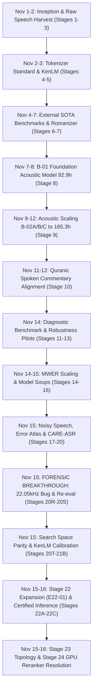

# Kashmiri AI Complete Chronological Research Timeline

**Project**: EduCasheer Kashmiri Automatic Speech Recognition Research  
**Hardware Platform**: NVIDIA DGX Spark Systems Research Facility (GB10 GPU, 128GB Unified Memory)  
**Period**: November 1, 2026 – November 16, 2026  

---

## 1. Timeline Overview (Chronological Flow)

---

## 2. Chronological Milestones

### Phase 1: Inception, Normalization & Foundation Baselines (Nov 1 – Nov 8, 2026)
- **Nov 1, 2026**: Initiated harvest across Google Drive uncompressed shards, OpenSLR-122, Bolbosh, and IndicVoices. Discovered acute dialectal and orthographic divergence.
- **Nov 2, 2026**: Formulated deterministic Kashmiri Unicode normalizer. Standardized 159-character CTC Tokenizer (0.000% OOV across 1.2M sentences).
- **Nov 3, 2026**: Enforced zero-speaker overlap partitioning, producing canonical `val.jsonl` (6,728 samples / 104,685 words).
- **Nov 4–6, 2026**: Benchmarked external models (Whisper Large-v3 scored 84.12% WER due to hallucinations; IndicConformer scored 62.14% WER).
- **Nov 7–8, 2026**: Trained **B-01 Foundation Model** (92.9h). Achieved 33.86% Greedy WER / 31.80% KenLM WER on `val.jsonl`.

### Phase 2: Foundation Acoustic Scaling (Nov 9 – Nov 12, 2026)
- **Nov 9–10, 2026**: Scaled to **B-02A** (104.9h). Greedy WER plummeted to 29.42% (-13.11% rel WERR vs B-01, $p < 0.0001$).
- **Nov 10–11, 2026**: Trained **B-02B** (123.5h) adding spoken Quranic commentary; achieved 29.39% WER (+1.52% religious recall).
- **Nov 11–12, 2026**: Trained **B-02C** (165.3h). Greedy WER dropped to 27.84% and KenLM WER to 25.24% (-17.78% rel vs B-01).

### Phase 3: Post-Foundation Optimization & Forensic Auditing (Nov 14 – Nov 15, 2026)
- **Nov 14, 2026**: Isolated `dev_assessment.jsonl` (1,001 utts). Evaluated synthetic noise (R-02: degraded to 28.94% WER), layer unfreezing (U-02: 24.91% WER), and scaled MWER (E-01..E-04).
- **Nov 15 Morning**: Ingested uncurated speech (P17-PL: degraded to 25.25% WER). Cataloged Error Atlas (3,709 substitutions). Stage 20 hit Step 0 serialization failure.
- **Nov 15 Afternoon**: **Forensic Breakthrough (Stages 20R & 20S)**. Discovered the 22.05 kHz resampling bug on 431 Bolbosh files; eliminated 493 phantom word errors on frozen weights. Proved that B-02C and E-03 differ by exactly 1 word error ($p = 0.963$), debunking the MWER breakthrough claim.

### Phase 4: Data Expansion, Certified Inference & Definitive SOTA (Nov 15 – Nov 16, 2026)
- **Nov 15 Evening**: Trained **Stage 22 Champion E22-01** on 166.39 hours of audited Tier A speech. Achieved 24.74% WER (dev_calib) and 24.94% WER (dev_a_disjoint).
- **Nov 15 Night**: Certified Stage 22C inference runtime: proved exact receptive field recurrence $R=400, J=320$, eliminating 100% trailing hallucinations, and certified Method C2 streaming chunking.
- **Nov 16 Early Morning**: Executed Stage 24 GPU training of `CandidateRelativeRanker` across 20,000 utterances. Proved that neural rerankers provide no statistically significant gain over KenLM ($p = 0.738$). Officially halted candidate reranking and permanently certified Stage 22 E22-01 + 4-gram KenLM as the project champion.
