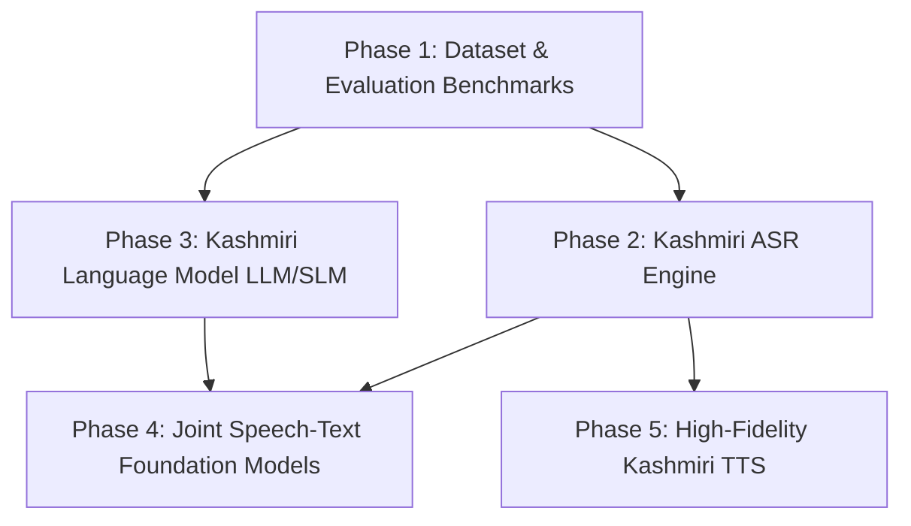

# Kashmiri AI Research Roadmap: Phased Execution Plan

A structured, realistic engineering and research roadmap to transition Kashmiri language AI from low-resource status to competitive performance across ASR, TTS, and LLMs.

---

---

## Phase 1: Research-Grade Dataset & Evaluation Benchmarks (Current)
*Target: Establish clean, verified multimodal data foundations.*

1. **Audio Standardization**:
   - Ingest raw audio across OpenSLR 122, KTTS, Kashmiri Audio Corpus, and XKaab ASR.
   - Standardize to 16 kHz 16-bit Mono PCM.
   - Fix container/codec mismatches (WebM Opus in KTTS).
   - Slice continuous recordings into discrete sentence clips with 50ms padding.
2. **Text Normalization**:
   - Apply NFC Unicode normalization, standardize Perso-Arabic orthography (Kaf, Heh, Yeh).
   - Implement dual-mode normalizer (diacritic-preserving for training, stripped for WER scoring).
3. **Partitioning with Zero Speaker Leakage**:
   - Partition into Train (~80%), Validation (~10%), and Test (~10%).
   - Guarantee strict mutual exclusivity of speakers: `train_spks ∩ test_spks = ∅`.
   - Build specialized benchmark test slices: `test_clean`, `test_noisy`, `test_code_switched`, `test_speaker_unseen`.
4. **External Open Dataset Expansion**:
   - Ingest Bolbosh (11.8 GB), IndicVoices, Aya Kashmiri, and Wikipedia dumps.

---

## Phase 2: Kashmiri Automatic Speech Recognition (ASR)
*Target: Achieve <20% WER on clean Kashmiri speech and <28% on conversational speech.*

1. **Acoustic Baseline 1 — IndicConformer Large (120M)**:
   - Fine-tune `ai4bharat/indicconformer_stt_ks_hybrid_ctc_rnnt_large` using NeMo framework.
   - Loss: Joint CTC + RNNT loss.
   - Data Augmentation: SpecAugment (frequency and time masking), speed perturbation (0.9x, 1.0x, 1.1x).
2. **Acoustic Baseline 2 — Whisper-Small / Medium**:
   - Fine-tune `openai/whisper-small` using Hugging Face Transformers and PyTorch with LoRA (rank=16, alpha=32).
   - Target modules: `q_proj`, `v_proj`.
   - Evaluation: Evaluate on `test_clean` and `test_noisy` under both raw Kashmiri text and normalized text.
3. **Evaluation Metrics**:
   - Word Error Rate (WER)
   - Character Error Rate (CER)
   - Code-switched English lexical token accuracy

---

## Phase 3: Kashmiri Language Model (LLM / SLM)
*Target: Develop a fluent Kashmiri understanding and generative Small Language Model (SLM).*

1. **Tokenizer Optimization**:
   - Standard tokenizers exhibit high fertility (>4x) on Kashmiri text.
   - Train a custom SentencePiece Byte-Pair Encoding (BPE) tokenizer with a 16,000-token Kashmiri vocabulary.
   - Expand the embedding matrix of a modern base model (Qwen-2.5-7B or Llama-3.1-8B) with the new Kashmiri tokens.
2. **Continued Pretraining (CPT)**:
   - Pretrain the adapted model on ~50M+ tokens from Koshur Pixel text, Sangraha, Wikipedia, and parallel corpora.
   - Learning rate: 2e-5 with cosine decay and warmup.
3. **Supervised Fine-Tuning (SFT)**:
   - Instruction-tune the model using our downloaded Aya Kashmiri (100k+ pairs) and Kreedz QA dataset.
   - Prompt format: ChatML (`<|im_start|>user ... <|im_end|>`).

---

## Phase 4: Speech Foundation Model & Joint Modeling
*Target: Explore end-to-end speech translation and multi-task speech-text understanding.*

1. **Joint Speech-Text Modeling**:
   - Train a projection layer (linear or Q-Former) between our fine-tuned ASR audio encoder and the Kashmiri LLM.
   - Direct Kashmiri audio input → Kashmiri / English text output without cascading ASR and LLM errors.
2. **Speech Translation**:
   - Train Kashmiri speech → English text translation using parallel audio alignments.

---

## Phase 5: High-Fidelity Kashmiri Text-to-Speech (TTS)
*Target: Produce natural, culturally resonant Kashmiri voice synthesis.*

1. **Model Framework**:
   - Adapt **Matcha-TTS** (Optimal Transport Conditional Flow Matching) and **VITS** on Bolbosh multi-speaker and KTTS single-speaker data.
2. **Diacritic & Phonetic Awareness**:
   - Incorporate `Koshur-JibDiacritizer` as a text front-end to ensure vowels are explicit before acoustic feature extraction.
3. **Evaluation**:
   - Mean Opinion Score (MOS) target: > 4.0 / 5.0.
   - Mel-Cepstral Distortion (MCD) target: < 5.0 dB.
