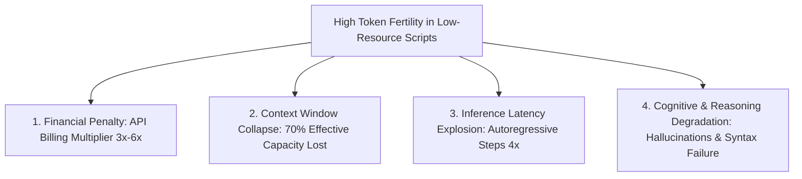

# Chapter 2: The Problems with Normal Tokenizers & The Multilingual Tax

---

## 1. Introduction: The Structural Inequity of Modern Tokenizers

Foundation language models (GPT-4o, LLaMA-3, Mistral, Gemini, Claude) are celebrated as universal multilingual intelligences. However, beneath the transformer architecture lies an invisible bottleneck: **the tokenizer**.

Most mainstream tokenizers are trained on internet corpora heavily dominated by English and Latin-script languages (typically >85% English, code, and European languages). Because subword algorithms (BPE, WordPiece, Unigram) are strictly frequency-driven optimizers, they dedicate the overwhelming majority of their finite vocabulary slots to English words, stems, and common phrases.

For non-Latin, low-resource, and morphologically complex languages like **Kashmiri (کٲشُر)**, Urdu, Persian, Pashto, and Arabic, standard tokenizers fail catastrophically. Instead of representing meaningful words or grammatical morphemes as single tokens, they fragment text into arbitrary byte-level splinters.

This phenomenon is scientifically documented as the **"Tokenization Tax"** (or the *Multilingual Double Penalty*).

---

## 2. Quantifying the Tokenization Tax: The Mathematics of Fertility

To understand the severity of tokenizer failure, researchers utilize three core metrics:

### 2.1 Token Fertility
Token fertility measures the average number of subword tokens produced per natural word:
$$\text{Fertility}(D, T) = \frac{\sum_{w \in D} |T(w)|}{|D|}$$
where $D$ is a text corpus, $w$ are whitespace-delimited words, and $T(w)$ is the token sequence produced by tokenizer $T$.

- **English Baseline**: Fertility sits between **1.10 and 1.25** tokens per word. Over 80% of English words are represented as a single, unified token.
- **Kashmiri on LLaMA-3 / GPT-4**: Fertility skyrockets to **4.10 – 4.80** tokens per word. A simple 10-word sentence explodes into nearly 50 tokens.

```
+-------------------------------------------------------------------------------+
| SENTENCE: "کٲشُر زَبان چھِ ہِندوستٲنۍ جۆم تہٕ کٔشیٖر ہٕنٛز مقٲمی زَبان۔"             |
| Meaning: "Kashmiri language is the primary native language of J&K."           |
| Word Count: 10 words                                                          |
+-------------------------------------------------------------------------------+
| Standard Multilingual LLM Tokenizer (LLaMA-3 / Tiktoken):                     |
| Tokens Produced: 43 tokens                                                    |
| Fragmentation: [ک, ٲ, ش, ُر, _ز, َ, ب, ان, _چ, ھ, ِ, _ہ, ِ, ن, د, و, س, ...]      |
| Fertility: 4.30 tokens / word                                                 |
+-------------------------------------------------------------------------------+
| KathAI Kashmiri Specialized BPE (16k Vocab):                                  |
| Tokens Produced: 16 tokens                                                    |
| Fragmentation: [کٲشُر, _زَبان, _چھِ, _ہِندوستٲنۍ, _جۆم, _تہٕ, _کٔشیٖر, _ہٕنٛز, ...]     |
| Fertility: 1.60 tokens / word                                                 |
+-------------------------------------------------------------------------------+
```

### 2.2 Compression Efficiency (Characters per Token)
$$\text{CharsPerToken}(D, T) = \frac{\text{Total Unicode Characters in } D}{\text{Total Tokens produced by } T}$$
- In English: ~4.0 to 4.5 characters per token.
- In Kashmiri under standard tokenizers: ~1.2 to 1.4 characters per token.

---

## 3. The Four Catastrophic Penalties

The high fertility of standard tokenizers does not merely represent an aesthetic inefficiency; it degrades every layer of model operation:



### 3.1 The Financial Penalty (API Discrimination)
Commercial frontier LLM APIs (OpenAI, Anthropic, Google, Cohere) bill developers strictly based on **tokens processed and generated**:
$$\text{Cost} = N_{\text{tokens}} \times \text{PricePerToken}$$

Because a Kashmiri or Urdu prompt consumes 3.5x to 5x more tokens than an English prompt expressing the identical semantic meaning:
- An enterprise processing customer support tickets in English pays \$1,000 / month.
- The exact same enterprise processing the identical tickets in Kashmiri pays **\$3,500 – \$5,000 / month**.

This creates a systemic economic barrier against technology adoption in the Global South and non-Western linguistic communities.

### 3.2 Context Window Cannibalization
Every transformer model is bounded by a maximum context length $N_{\text{ctx}}$ (e.g., 8,192 tokens or 32,768 tokens). Because attention computation scales quadratically ($O(N^2)$) and KV-cache scales linearly ($O(N)$), context space is the most precious resource in an LLM application.

Consider a 32,768-token context window:
- In English ($\text{Fertility} = 1.15$): Holds **~28,500 words** of text (an entire 90-page novel, multiple PDFs, or 50 few-shot exemplars).
- In Kashmiri ($\text{Fertility} = 4.30$): Holds **barely 7,600 words** (a short 20-page document).

**The Downstream Damage**:
1. **Retrieval-Augmented Generation (RAG)**: Where an English RAG pipeline can inject 10 retrieved chunks into the prompt, a Kashmiri RAG pipeline can inject only 2 chunks before overflowing the context.
2. **Few-Shot In-Context Learning**: Multi-turn dialogue history is prematurely evicted, leading to early conversational amnesia.

### 3.3 Autoregressive Generation Latency & Throughput
In generative language models, inference is autoregressive: generating $K$ tokens requires $K$ sequential forward passes through all transformer layers:
$$\text{Latency} \propto K_{\text{tokens}} \times t_{\text{forward}}$$

If generating a 200-word response in English requires 230 tokens, generation takes 4.6 seconds (at 50 tokens/sec). Generating the exact same 200-word response in Kashmiri requires **900 tokens**, taking **18.0 seconds** (**a 4x latency penalty**). For real-time applications such as conversational voice bots or live transcription, this latency is unacceptable.

### 3.4 Cognitive & Semantic Degradation
Transformers build semantic representations through self-attention across tokens. In early layers ($L_1$ to $L_4$), self-attention heads learn syntactic dependencies and local lexical patterns.

When words are shattered into isolated bytes or single characters:
1. **Capacity Waste**: The model must expend 4 to 8 full transformer layers simply acting as a low-level character assembler, reconstructing basic words from fragmented bytes before any semantic reasoning can begin.
2. **Disrupted Long-Range Attention**: Because sequence length is inflated by 4x, the distance between semantically linked tokens (e.g., subject-verb agreement across a clause) is stretched 4-fold, exceeding the effective span of positional encodings.
3. **Elevated Hallucinations**: Multiple academic studies (e.g., Ahia et al., 2023; Petrov et al., 2024) demonstrate that models exhibit significantly higher perplexity, worse grammatical consistency, and higher hallucination rates on languages with high token fertility.

---

## 4. The Morphological Blindness of Frequency-Based Merging

Standard subword tokenizers are mathematically **morphologically agnostic**. They merge character pairs strictly based on string co-occurrence frequency, without any awareness of linguistic morphology (roots, affixes, clitics, case markers).

### 4.1 Cross-Boundary Merging
When high-frequency punctuation or whitespace merges with word beginnings:
- In English: `" apple"` is learned as a token, but `"apple"` is another token, and `"(apple"` is yet another. The model treats these as three unrelated vectors in embedding space.
- In Kashmiri: Prepositions and clitics attach directly to nouns:
  - *کٔشیٖر* (*Kashmir*)
  - *کٔشیٖرِ* (*of Kashmir / in Kashmir*)
  - *کٔشیٖرِ-مَنٛز* (*inside Kashmir*)
  - *کٔشیٖرِ-پؠٹھ* (*from Kashmir*)
A naive tokenizer splits these across arbitrary boundaries (e.g., `["کٔ", "شیٖ", "رِ", "مَن", "ٛز"]`), completely obscuring the root noun *کٔشیٖر* and the locative clitic *مَنٛز*.

---

## 5. Script and Unicode Normalization Pitfalls

Beyond token counts, standard tokenizers suffer from catastrophic failures when encountering non-Latin scripts, particularly Perso-Arabic orthographies.

### 5.1 The Multi-Byte UTF-8 Explosion
In standard ASCII (English), each character is encoded as a single 1-byte value (`0x00`–`0x7F`).
In Perso-Arabic scripts (Arabic, Urdu, Kashmiri), characters are encoded using **2 or 3 bytes**:
- `ک` (Keheh / U+06A9): 2 bytes (`0xD6 0xA9`)
- `ٲ` (Alef with Wavy Hamza / U+0672): 2 bytes (`0xD9 0xB2`)
- Kashmiri Palatalization Mark (`U+065A`): 2 bytes (`0xD9 0x9A`)
- Devanagari Kashmiri characters (`U+0900`–`U+097F`): 3 bytes

When a Byte-Level BPE tokenizer (like GPT-2 or LLaMA) encounters a Kashmiri character that was absent from its merge training, it cannot represent the character as a unit. It outputs **2 or 3 separate byte tokens** for a single visible letter! A 5-letter word can instantly require **15 tokens**.

### 5.2 Unicode Normalization Inconsistency: NFC vs. NFD
Unicode defines two primary normalization forms:
1. **NFC (Canonical Decomposition, followed by Canonical Composition)**: Precomposed characters are unified into a single codepoint.
   Example: `ٲ` (Alef with Wavy Hamza Above) is represented as `U+0672` (1 code point).
2. **NFD (Canonical Decomposition)**: Characters are separated into base letters and combining marks.
   Example: `ٲ` is decomposed into `U+0627` (Alef) + `U+065F` (Wavy Hamza Below/Above) (2 code points).

If a tokenizer is trained on NFC data but encounters NFD text at inference time:
- The base letter `U+0627` is tokenized as one token.
- The combining diacritic `U+065F` becomes an orphan token or byte fallback.
- The model fails to recognize the word, leading to severe inference degradation.

### 5.3 Zero-Width Characters: ZWNJ (`U+200C`) and ZWJ (`U+200D`)
In Perso-Arabic and Indic scripts, the **Zero-Width Non-Joiner (ZWNJ / `\u200c`)** is a critical orthographic symbol. It specifies that two adjacent cursive letters should **not** join into a ligature, even though they normally would.

In Kashmiri, ZWNJ is required for:
- Plural forms: *کتھ* (*bath/talk*) $\to$ *کتھہٕ* with unjoined suffix.
- Compound nouns: *دل‌چسپ* (*interesting*) where *ل* and *چ* must not connect cursively.

**How Normal Tokenizers Fail**:
1. Many tokenizers treat `U+200C` as whitespace and split the word into two independent fragments.
2. Other tokenizers strip ZWNJ entirely during regex pre-filtering, corrupting the visual and orthographic validity of the text.
3. When preserved, ZWNJ often has no merges, causing it to fall back to an isolated 3-byte sequence (`0xE2 0x80 0x8C`).

### 5.4 Arabic Presentation Forms (The Compatibility Trap)
In Unicode, characters in the blocks `U+FB50`–`U+FDFF` (Presentation Forms-A) and `U+FE70`–`U+FEFF` (Presentation Forms-B) represent visual glyph shapes (isolated, initial, medial, and final forms of Arabic letters, such as `ﺀ`, `ﺁ`, `ﺄ`, `ﻳ`).

Modern NLP standards require using canonical Arabic codepoints (`U+0600`–`U+06FF`), allowing font shaping engines (HarfBuzz) to render glyph shapes dynamically. However, OCR engines and legacy web documents frequently dump visual presentation forms directly into text. A standard tokenizer sees `ﻳ` (`U+FEF2`) and `ی` (`U+06CC`) as completely different, unrelated tokens, fragmenting the vocabulary and ruining retrieval.

---

## 6. Arithmetic and Number Tokenization Pathologies

Standard tokenizers are notoriously erratic at tokenizing numbers:
- In English: `1234` might be tokenized as `["12", "34"]`, while `12345` becomes `["123", "45"]`, and `123456` becomes `["12", "34", "56"]`.
- In Kashmiri/Urdu/Arabic: Numerals can appear as Eastern Arabic/Persian digits (`۰, ۱, ۲, ۳, ۴, ۵, ۶, ۷, ۸, ۹`) or Western Arabic digits (`0, 1, 2, ...`).

When an LLM attempts arithmetic on numbers tokenized into irregular chunks, positional attention heads cannot track place values (units, tens, hundreds, thousands), causing the model to hallucinate basic arithmetic calculations.

---

## 7. The "Glitch Token" Pathology

In 2023, researchers discovered the phenomenon of **"Glitch Tokens"** (such as `"SolidGoldMagikarp"`, `"StreamerBot"`, `"petertodd"`) in models like GPT-2, GPT-3, and LLaMA.

### How Glitch Tokens Arise
1. Subword tokenizers are trained on massive raw internet crawls containing automated web scrapes, Reddit user handles, repeated code logs, and spam strings.
2. Certain non-linguistic strings appear millions of times in repetitive logs and are assigned unique, dedicated tokens in the vocabulary table.
3. During LLM pretraining, these tokens appear with zero semantic or syntactic variety, receiving virtually zero meaningful gradient updates.
4. Their embedding vectors end up with anomalous norms and negative dot products relative to the rest of the vocabulary space.
5. If a user prompts the model with these tokens, the model's attention mechanism destabilizes, producing bizarre loops, vulgarities, or complete hallucinations.

In multilingual tokenizers, poorly normalized Urdu/Kashmiri web scrapes have generated dozens of "zombie" glitch tokens that cause the model to crash or switch languages unpredictably.

---

## 8. Summary: The Verdict on Normal Tokenizers

| Problem Dimension | Impact on Low-Resource Scripts (Kashmiri) | Engineering Requirement |
| :--- | :--- | :--- |
| **High Fertility (>4.0)** | 4x slower generation, 75% context loss, 4x higher API bills | Train a custom high-coverage subword vocabulary |
| **Byte Splitting** | Single letters broken into 2–3 raw byte tokens | Register native characters as atomic symbols |
| **Unicode Drift** | Inconsistent NFC/NFD decomposition | Strict pre-tokenization Unicode normalization |
| **ZWNJ Corruption** | Disconnected ligatures or illegal splits | Explicit ZWNJ retention in token vocabulary |
| **Morphological Fragmentation** | Roots and clitics severed arbitrarily | Morphologically aligned pre-tokenization regex |

Standard tokenizers are simply not built for languages like Kashmiri. To achieve state-of-the-art language modeling, a custom, culturally and linguistically authentic tokenization architecture is mandatory.
