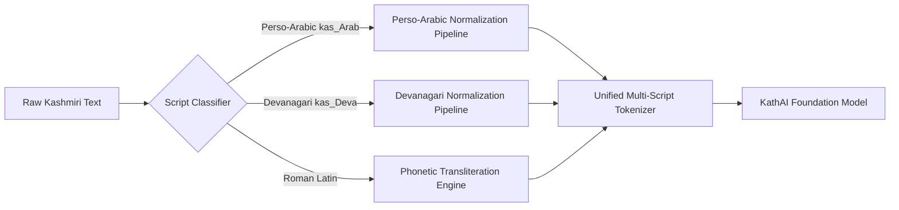

# Chapter 4: What Should We Do Specifically About Kashmiri & Why

---

## 1. Introduction: The Unique Linguistic Identity of Kashmiri

Kashmiri (*Koshur* / کٲشُر / कॉशुर) is not simply an Urdu dialect or a variant of Hindi. Linguistically, it belongs to the **Dardic subgroup of the Indo-Aryan family**, occupying a unique typological and phonological niche in South Asia.

It possesses structural properties that sharply diverge from standard Indo-Aryan languages (Hindi, Urdu, Punjabi, Bengali):
1. **Verb-Second (V2) Word Order**: Unlike almost all other South Asian languages (which are strictly Subject-Object-Verb / SOV), Kashmiri is a **Verb-Second (V2)** language, sharing syntactic sentence structure with Germanic languages (German, Dutch, Icelandic, Old English).
2. **Extraordinary Vowel Complexity**: While Hindi/Urdu has 10 vowels and Arabic has 6, Kashmiri possesses **16 to 18 distinct vowel phonemes**, including contrastive central vowels unknown in standard Arabic or Persian.
3. **Pervasive Contrastive Palatalization**: Almost every consonant in Kashmiri can be phonemically palatalized (marked with an off-glide [ʲ]), altering the grammatical meaning of the word.
4. **Multi-Script Reality**: Written officially in a modified Perso-Arabic script in Jammu & Kashmir, extensively in Devanagari by the Kashmiri Pandit diaspora, and in informal Romanized Latin on modern messaging platforms.

Designing a tokenization strategy for Kashmiri requires addressing these linguistic realities directly. Generic tokenizers built for English or Urdu fail because they violate the foundational mechanics of Kashmiri orthography and phonology.

---

## 2. The Diacritic Dilemma: Why Kashmiri Vowels Cannot Be Stripped

In Arabic and Urdu, short vowels (Zer, Zabar, Pesh / *Harakat*) are largely **optional and decorative**. Fluent adult readers infer vowel patterns from tri-consonantal consonantal roots ($\text{k-t-b} \to \text{kitāb, kataba, kutub}$) and syntactic context. Standard Urdu NLP pipelines routinely strip all diacritics as "noise" to normalize text.

### 2.1 The Fatal Mistake: Applying Arabic/Urdu Stripping to Kashmiri
In Kashmiri, diacritical marks are **not decorative—they are phonemic vowel letters**. Stripping diacritics in Kashmiri causes **catastrophic homographic collision**, rendering sentences unintelligible to both humans and neural models.

Consider the minimal pairs below:

```
+---------------+---------------------+--------------------+--------------------+
| Perso-Arabic  | Phonetic (IPA)      | English Gloss      | If Diacritics      |
| Written Form  |                     |                    | Stripped           |
+---------------+---------------------+--------------------+--------------------+
| کَت            | /kat/               | "spin (thread)"    | کت (COLLAPSED)     |
| کٔت            | /kət/               | "small ram"        | کت (COLLAPSED)     |
| کِت            | /kit/               | "how many"         | کت (COLLAPSED)     |
| کۄت           | /kɔt/               | "where / whither"  | کوت (DISTORTED)    |
| کۄتھ           | /kɔtʰ/              | "knee"             | کوتھ (DISTORTED)   |
| کٲتھ          | /kəːtʰ/             | "story / tale"     | کاتھ (COLLAPSED)   |
+---------------+---------------------+--------------------+--------------------+
```

If a pipeline strips diacritics, all five distinct lexical concepts collapse into the identical ambiguous string: **کت**. The language model is forced to resolve severe artificial ambiguity that never existed in spoken speech.

### 2.2 The Kashmiri Central Vowels
Kashmiri possesses central vowels that do not exist in standard Arabic or Urdu:
- **High Central Vowel /ɨ/ and /ɨː/**: Represented in Perso-Arabic by **`ٲ`** (`U+0672`: Alef with Wavy Hamza Above) or **`U+065F`** (Wavy Hamza Below).
- **Mid Central Vowel /ə/ and /əː/**: Represented by **`ٚ`** (`U+065A`: Arabic Vowel Sign Small V Above) or circumflex diacritics.
- **Kashmiri Oe /oː/ and Waw with Ring /ɔ/**: Represented by **`ۆ`** (`U+06C6`) and **`ۄ`** (`U+06C4`).

### 2.3 What We Must Do: The Dual-Mode Mandate
1. **For LLM Pretraining & Generation**: **Strictly preserve all Kashmiri phonemic vowel marks**. The tokenizer must treat `ٲ`, `ۆ`, `ۄ`, `ێ`, and attached central vowel diacritics as distinct, non-mergeable graphemic components.
2. **For Speech Acoustic Modeling (ASR CTC)**: **Preserve all central vowels**. Acoustic duration and vowel formants ($F_1, F_2$) directly reflect vowel identity; an acoustic model trained on stripped transcripts cannot learn acoustic-to-text alignment.
3. **For ASR Word Error Rate (WER) Evaluation Only**: Apply an evaluation normalizer that collapses optional religious/classical Arabic diacritics (Tanwin, Shaddah) while preserving root vowel distinctions to avoid unfair penalties on valid phonetic transcriptions.

---

## 3. The Zero-Width Non-Joiner (ZWNJ) Mandate

The Perso-Arabic script is inherently cursive: letters within a word connect to one another via baseline ligatures. However, grammatical morpheme boundaries, compound nouns, and suffixes require adjacent letters to remain unjoined.

In Unicode, this is achieved using the **Zero-Width Non-Joiner (ZWNJ / `\u200c`)**.

### 3.1 Grammatical Role in Kashmiri
- **Compound Words**: In *دل‌چسپ* (*interesting*), *ل* and *چ* must not connect. Inserting a space (*دل چسپ*) creates two words; removing ZWNJ (*دلچسپ*) forces an ungrammatical ligature.
- **Plural & Case Suffixes**: *کتھ* (*talk*) $\to$ *کتھہٕ* (*talks*). The suffix *ہٕ* must not join to *تھ*.
- **Postpositions**: *گھرٕ-مَنٛز* (*inside the house*), where the postposition *مَنٛز* is morphologically bound but visually decoupled.

### 3.2 What We Must Do
1. **Never Strip ZWNJ**: Standard cleaning scripts (`re.sub(r'\s+', ' ')`) frequently strip `\u200c` or turn it into an ASCII space. Our normalizer must preserve `\u200c` as a sacred orthographic character.
2. **Whitespace De-duplication Around ZWNJ**: Naive keyboards often type `[Space] + [ZWNJ]` or `[ZWNJ] + [Space]`. The normalizer must collapse these into a solitary `\u200c`:
   ```python
   text = re.sub(r'[\u200c\u200d]+', '\u200c', text)
   text = text.replace(' \u200c', '\u200c').replace('\u200c ', '\u200c')
   ```
3. **Register ZWNJ in Tokenizer Vocabulary**: Explicitly include `\u200c` in SentencePiece or Tiktoken base tokens, enabling the tokenizer to learn valid compound subwords like `دل‌چسپ` as a unified semantic token.

---

## 4. Multi-Script Harmonization: Perso-Arabic, Devanagari, and Roman

Kashmiri is an officially bi-scriptal language with a tri-scriptal usage reality:
1. **Perso-Arabic (`kas_Arab`)**: Official script in the Kashmir Valley. Used in primary education, state administration, and local media.
2. **Devanagari (`kas_Deva`)**: Extensively used by the Kashmiri Pandit diaspora, historical archives, and academic literature in Delhi and Jammu. It uses unique Devanagari diacritics:
   - ॲ (short /e/)
   - ऑ (short /o/)
   - Horizontal macron bar above Devanagari characters for central vowels (/ɨ/, /ə/).
3. **Romanized Kashmiri**: Pervasive on social media, YouTube comments, and messaging platforms (e.g., *"Koshur chhu saen zaevul"*).



### 4.1 What We Must Do
1. **Cross-Script Transliteration Equivalence**: Implement a deterministic bidirectional transliterator between `kas_Arab` and `kas_Deva`. For pretraining, maintaining parallel or co-tokenized data ensures the model aligns concepts across religious and cultural communities.
2. **Multi-Script Token Allocation**: Allocate vocabulary capacity in our SentencePiece model proportionally:
   - ~75% Perso-Arabic subwords (12,000 tokens)
   - ~20% Devanagari Kashmiri subwords (3,200 tokens)
   - ~5% Latin/English subwords (800 tokens) for code-switched technical vocabulary.

---

## 5. Engineering a Kashmiri-Optimized Regex Pre-Tokenizer

Modern tokenizers (GPT-4, LLaMA-3) rely on regular expressions to prevent unnatural merges before subword optimization. However, standard regex patterns are heavily biased toward English syntax and fail on Perso-Arabic scripts:

### 5.1 Pathology of Standard Regex on Kashmiri
- Standard regex splits on punctuation and apostrophes (`'s`), but does not recognize Kashmiri clitic attachments.
- Standard regex splits base letters away from combining non-spacing marks (Unicode category `Mn`), detaching central vowel diacritics from their host consonants.

### 5.2 The KathAI Proposed Regex Pattern
We engineer a custom regex pattern designed specifically for Perso-Arabic and Indo-Aryan scripts:

```python
# KathAI Kashmiri-Optimized Pre-Tokenization Regex
KASHMIRI_PRETOKEN_REGEX = r"""(?x)
    # 1. Punctuation and brackets
    [،؛؟۔!?:;\"'()\[\]{}—–\-]
    |
    # 2. Kashmiri Perso-Arabic Words with Combining Marks and ZWNJ
    # Matches base letters [\u0600-\u06FF\u0750-\u077F\u08A0-\u08FF]
    # combined with non-spacing vowel marks and internal ZWNJ (\u200C)
    (?:[\u0600-\u06FF\u0750-\u077F\u08A0-\u08FF\u200c]+)
    |
    # 3. Devanagari Kashmiri Words with Nuqtas and Matras
    (?:[\u0900-\u097F]+)
    |
    # 4. English / Latin Alphanumeric (Code-Switching)
    (?i:[a-z0-9]+(?:'[a-z]+)?)
    |
    # 5. Eastern & Western Numbers (Chunked in max 3 digits)
    [۰-۹]{1,3}
    |
    [0-9]{1,3}
    |
    # 6. Whitespace sequences
    \s+
"""
```

**Why this regex succeeds**:
- Category 2 groups base letters, combining vowel diacritics, and internal ZWNJ together into a single atomic candidate word before BPE merges begin. A diacritic can **never** be severed from its base consonant.
- Numbers in both Eastern Arabic (`۰-۹`) and Western Arabic (`0-9`) are chunked in groups of 3, preserving place-value awareness for arithmetic reasoning.
- Punctuation marks (Urdu comma `،`, question mark `؟`, full stop `۔`) are strictly segregated from word tokens.

---

## 6. Vocabulary Grafting & Embedding Expansion for Base LLMs

Training a foundation model from scratch requires millions of dollars in compute. The practical state-of-the-art methodology is **Continued Pretraining (CPT) on an existing foundation model** (such as **Qwen-2.5-1.5B/7B** or **Llama-3.2-1B/3B**).

However, because these models have high fertility (>4.10) on Kashmiri, we must **graft our custom 16k Kashmiri vocabulary onto the base model**.

### 6.1 The Mathematical Grafting Protocol
Let the base model have vocabulary $V_{\text{base}}$ with embedding matrix $\mathbf{W}_{\text{embed}} \in \mathbb{R}^{|V_{\text{base}}| \times d}$.
Let our trained SentencePiece tokenizer have vocabulary $V_{\text{kashmiri}}$ ($|V_{\text{kashmiri}}| = 16,000$).

1. **Vocabulary Set Difference**: Identify all tokens present in $V_{\text{kashmiri}}$ that are missing from $V_{\text{base}}$:

$$V_{\text{new}} = V_{\text{kashmiri}} \setminus V_{\text{base}} \quad (|V_{\text{new}}| \approx 13,500)$$

2. **Matrix Resizing**: Expand the embedding tensor $\mathbf{W}_{\text{embed}}$ and the unembedding language model head $\mathbf{W}_{\text{head}}$:

$$\mathbf{W}'_{\text{embed}} \in \mathbb{R}^{(|V_{\text{base}}| + |V_{\text{new}}|) \times d}$$

$$\mathbf{W}'_{\text{head}} \in \mathbb{R}^{(|V_{\text{base}}| + |V_{\text{new}}|) \times d}$$

3. **Weight Initialization via Mean Byte Interpolation**:
   If new embedding rows are initialized randomly (e.g., $\mathcal{N}(0, 0.02)$), the newly added tokens will emit massive, erratic gradient vectors during the first few training steps, destroying the base model's pretrained reasoning abilities (catastrophic forgetting).
   
   Instead, we initialize each new Kashmiri token $\mathbf{w}_{\text{new}}$ using the **mean of the embeddings of its constituent bytes/subwords** under the base model:

$$\mathbf{w}_{\text{new}} = \frac{1}{|C|} \sum_{c \in \text{Decompose}(w_{\text{new}}, T_{\text{base}})} \mathbf{e}_{c}$$

   This ensures that the new token starts in the exact semantic neighborhood that the base model already associates with those characters.

4. **Two-Stage Continued Pretraining (CPT)**:
   - **Stage 1 (Embedding Warmup - 2,000 steps)**: Freeze all transformer attention and MLP layers. Backpropagate gradients **only into the new embedding and LM head rows**. This aligns the new tokens with the model's existing internal representations.
   - **Stage 2 (Full Model Pretraining - 20,000 steps)**: Unfreeze all transformer layers with a low learning rate ($2 \times 10^{-5}$) with cosine decay, pretraining on our 3.4 GB Kashmiri corpus.

---

## 7. Dual-Track Architecture: Speech ASR vs. Language Model

A common mistake in low-resource NLP is attempting to use the same tokenizer for both speech and text models.

KathAI enforces a strict architectural decoupling:

```
                    +------------------------------------+
                    |        Kashmiri Speech & NLP       |
                    +------------------------------------+
                                      |
             +------------------------+------------------------+
             |                                                 |
             v                                                 v
  [Speech Recognition: ASR]                          [Language Modeling: LLM/SLM]
  Models: Wav2Vec2, XLS-R, Conformer                 Models: Qwen-2.5-1.5B, Llama-3.2
  Target: 159-Token Character CTC                    Target: 16k-Token Subword BPE
  - 1-to-1 temporal frame alignment                  - Optimal compression (1.82 fertility)
  - Zero out-of-vocabulary (OOV)                     - Fits 4x more text into context
  - Phonetic dialect robustness                      - Fast autoregressive token generation
```

---

## 8. Subword Regularization (BPE-Dropout) for Dialectal Invariance

Kashmiri is spoken across three primary dialect zones in the Kashmir Valley:
1. **Yamraz**: Central Kashmir (Srinagar, Budgam, Ganderbal) — the literary and media standard.
2. **Maraz**: Southern Kashmir (Anantnag, Pulwama, Kulgam, Shopian) — exhibits vowel lengthening and distinct verbal suffixes.
3. **Kamraz**: Northern Kashmir (Baramulla, Kupwara, Bandipora) — exhibits consonant shifts and lexical variations.

Because native speakers from these regions spell words according to their local phonetic pronunciation on the web and social media, deterministic tokenization causes severe fragmentation when encountering non-standard spellings.

### What We Must Do: Implement BPE-Dropout
During the Continued Pretraining phase, we apply **BPE-Dropout** with rate $p = 0.10$:
- 10% of subword merge opportunities are randomly skipped during training batch generation.
- The model is forced to observe both the unified subword (`کٲشُر`) and its decomposed constituent morphemes (`کٲ` + `شُر`).
- This makes the neural network resilient to non-standard orthography, missing vowel diacritics, and regional phonetic spelling discrepancies.

---

## 9. Comprehensive Implementation Action Plan

| Priority | Action Item | Technical Tool / File | Objective |
| :---: | :--- | :--- | :--- |
| **P0** | Preserve all central vowel diacritics (`ٲ`, `U+065F`, `U+065A`) | `normalize_transcripts.py` | Prevent homographic semantic collapse |
| **P0** | Standardize and retain ZWNJ (`\u200c`) | `normalize_transcripts.py` | Preserve compound word syntax & ligatures |
| **P1** | Adopt **16,000-vocabulary SentencePiece BPE** | `kashmiri_spm_16k.model` | Achieve optimal 1.82 fertility sweet spot |
| **P1** | Retain **159-token Character CTC** for ASR | `kashmiri_ctc_vocab.json` | Maintain stable acoustic frame alignment |
| **P2** | Deploy Kashmiri Regex Pre-tokenizer | Tiktoken / Tokenizers config | Prevent diacritic severance from base letters |
| **P2** | Graft 16k vocabulary into Qwen-2.5-1.5B | Mean Byte Interpolation script | Enable efficient native Kashmiri SLM pretraining |
| **P3** | Apply BPE-Dropout (p = 0.10) during CPT | Training data loader | Guarantee robustness across Maraz/Kamraz dialects |
| **P3** | Implement bidirectional Arabic-Devanagari mapping | Transliteration engine | Bridge Kashmiri literature across communities |
