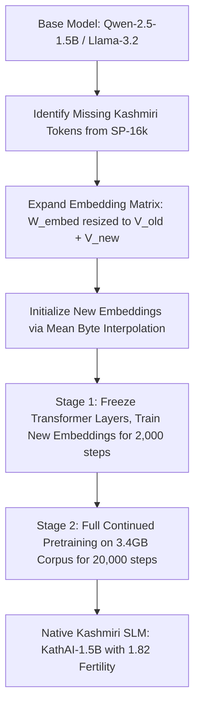

# The Definitive Tokenization Handbook: Theory, Algorithms, Multilingual Pathologies, and the Kashmiri Blueprint

**Author**: Musavir Khaliq & The KathAI AI Research Team  
**Repository**: `Musavirkhaliq/KathAI`  
**Location**: `reading/MASTER_TOKENIZATION_HANDBOOK.md`  
**Date**: November 2026  
**Subject**: Exhaustive Technical Treatise on Subword Tokenization, Foundation Model Biases, and Native Kashmiri (*Koshur*) Natural Language Processing  

---

## Table of Contents

1. [Executive Summary & Foundational Motivation](#1-executive-summary--foundational-motivation)
2. [Mathematical Foundations & Information Theory](#2-mathematical-foundations--information-theory)
3. [Deep Algorithmic Formulations: BPE, WordPiece, Unigram, and BBPE](#3-deep-algorithmic-formulations-bpe-wordpiece-unigram-and-bbpe)
4. [The Multilingual Tokenization Tax: The Double Penalty on Non-Latin Scripts](#4-the-multilingual-tokenization-tax-the-double-penalty-on-non-latin-scripts)
5. [What Was Done in KathAI: Empirical Experiments, Models, and Benchmarks](#5-what-was-done-in-kathai-empirical-experiments-models-and-benchmarks)
6. [The Linguistic and Orthographic Architecture of Kashmiri (Koshur)](#6-the-linguistic-and-orthographic-architecture-of-kashmiri-koshur)
7. [The Engineering Blueprint: What We Must Do for Kashmiri and Why](#7-the-engineering-blueprint-what-we-must-do-for-kashmiri-and-why)
8. [Vocabulary Expansion & Embedding Grafting for Foundation LLMs](#8-vocabulary-expansion--embedding-grafting-for-foundation-llms)
9. [Comprehensive Master Reference Tables](#9-comprehensive-master-reference-tables)

---

## 1. Executive Summary & Foundational Motivation

Modern artificial intelligence relies on transformer architectures that process discrete tokens rather than continuous acoustic waveforms or raw human text. The translation layer that converts natural human language into discrete token identifiers—the **tokenizer**—is often treated as a solved, mechanical preprocessing detail.

In reality, the tokenizer is the primary gatekeeper of language model intelligence, computational throughput, context window memory, and commercial accessibility. When tokenizers are trained on internet corpora dominated by English (>85%), they establish deep structural biases against low-resource, morphologically complex, and non-Latin script languages.

In **Kashmiri (*Koshur* / کٲشُر)**, standard tokenizers produced by frontier AI labs (OpenAI GPT-4, Meta LLaMA-3, Mistral) fragment native words into arbitrary byte-level splinters, inflicting a **4.1x token fertility penalty**. This effectively reduces a 32k context window to less than 8,000 words, quadruples autoregressive generation latency, inflates commercial API costs by 350% to 500%, and severely degrades semantic comprehension and factual reasoning.

This handbook establishes the theoretical, algorithmic, and empirical framework developed in the **KathAI (کتھ)** research project to eliminate the tokenization tax and provide a native, linguistically authentic tokenization architecture for Kashmiri.

---

## 2. Mathematical Foundations & Information Theory

### 2.1 Why Discrete Tokenization is Necessary
Neural networks are differentiable computational graphs that compute vector mappings in continuous spaces $\mathbb{R}^d$. A human text string is a discrete sequence of characters or bytes.

To bridge this divide, a language model requires:
1. **An Embedding Matrix** $\mathbf{E} \in \mathbb{R}^{|V| \times d_{\text{model}}}$, which maps each discrete token ID $i \in \{0, 1, \dots, |V|-1\}$ to a dense vector $\mathbf{e}_i \in \mathbb{R}^{d_{\text{model}}}$.
2. **A Softmax Projection Head** $\mathbf{W}_{\text{head}} \in \mathbb{R}^{|V| \times d_{\text{model}}}$, which computes a probability distribution over the discrete vocabulary at each generation step $t$:

$$P(y_t = i \mid y_{\lt t}) = \frac{\exp\left(\frac{\mathbf{h}_t \cdot \mathbf{w}_i^\top}{\tau}\right)}{\sum_{j=1}^{|V|} \exp\left(\frac{\mathbf{h}_t \cdot \mathbf{w}_j^\top}{\tau}\right)}$$

### 2.2 The Sequence-Vocabulary Trade-off
Language modeling operates under a strict trade-off between sequence length $N$ and vocabulary size $|V|$:

$$\text{Total Compute Cost} = \mathcal{O}(L \cdot N^2 \cdot d_{\text{model}} + N \cdot |V| \cdot d_{\text{model}})$$

- **If $|V|$ is small** (e.g., character or raw byte level, $|V| = 256$): The vocabulary projection is virtually free, but sequence length $N$ explodes by a factor of 4x to 8x. Because self-attention complexity scales quadratically with sequence length ($N^2$), processing long documents becomes computationally intractable.
- **If $|V|$ is large** (e.g., full words, $|V| = 500,000$): Sequence length $N$ is minimized, but the embedding and unembedding matrices consume billions of parameters ($2 \times |V| \times d_{\text{model}}$), and rare words suffer from severe parameter under-training due to Zipf's Law:

$$f(r) \propto \frac{1}{r^s} \quad (s \approx 1)$$

A word appearing only once or twice in the training corpus receives almost zero gradient updates, rendering its embedding vector noisy and ungeneralizable.

Subword tokenization is the discrete optimization method that identifies the Pareto-optimal frontier between sequence length and vocabulary size.

### 2.3 Information Theory & Shannon Entropy
From an information-theoretic perspective, tokenization is **lossless text compression**.

By Shannon's Source Coding Theorem, the minimum expected number of bits required to encode a symbol drawn from a distribution $P(X)$ is bounded by the Shannon Entropy:
$$H(X) = -\sum_{x \in X} P(x) \log_2 P(x)$$

An optimal subword vocabulary minimizes the expected code length of a corpus by assigning high-frequency character n-grams to individual tokens, while relegating rare strings to combinations of shorter subwords or base characters.

---

## 3. Deep Algorithmic Formulations: BPE, WordPiece, Unigram, and BBPE

```
+-----------------------------------------------------------------------------------------+
|                               THE SUBWORD ALGORITHM LANDSCAPE                           |
+-------------------+--------------------+------------------------+-----------------------+
| Algorithm         | Paradigm           | Optimization Metric    | Primary Adopters      |
+-------------------+--------------------+------------------------+-----------------------+
| Byte-Pair (BPE)   | Bottom-up merging  | Raw pair frequency     | GPT-2/3/4, LLaMA, RoBERTa
| WordPiece         | Bottom-up merging  | Likelihood / PMI score | BERT, DistilBERT      |
| Unigram LM        | Top-down pruning   | Corpus log-likelihood  | T5, mBART, ALBERT     |
| SentencePiece     | Unified framework  | Space-agnostic BPE/Uni | T5, LLaMA, XLM-R      |
| Byte-Level BPE    | 256-byte base BPE  | Raw UTF-8 byte merges  | Tiktoken, Mistral     |
+-------------------+--------------------+------------------------+-----------------------+
```

### 3.1 Byte-Pair Encoding (BPE)
Invented by Philip Gage (1994) for data compression and adapted for NLP by Sennrich et al. (2016):
- **Initialization**: Vocabulary $V$ contains all unique single characters in corpus $C$.
- **Pair Counting**: At each iteration, count the co-occurrence frequency of all adjacent symbol pairs $(s_i, s_j)$ across all words:

$$\text{freq}(s_i, s_j) = \sum_{w \in C} \text{count}((s_i, s_j) \text{ in } w) \times \text{freq}(w)$$

- **Greedy Merge**: Select the pair that maximizes frequency:

$$(s_a, s_b) = \arg\max_{(s_i, s_j)} \text{freq}(s_i, s_j)$$

- **Rule Construction**: Add $s_{\text{new}} = s_a \circ s_b$ to $V$ and record the merge rule $\mu: (s_a, s_b) \to s_{\text{new}}$. Repeat until $|V| = K$.
- **Inference**: Apply the learned list of merge rules strictly in the chronological order of their creation.

### 3.2 WordPiece
Developed by Schuster and Nakajima (2012) and adopted in Google BERT:
- Instead of raw pair frequency, WordPiece chooses merges that maximize the log-likelihood of a unigram language model over the training corpus:

$$\log P(C) = \sum_{w \in C} \sum_{t \in w} \log P(t)$$

- The selection criterion between adjacent tokens $x$ and $y$ evaluates their Pointwise Mutual Information (PMI):

$$\text{Score}(x, y) = \frac{\text{count}(x \circ y)}{\text{count}(x) \times \text{count}(y)} \propto \frac{P(x \circ y)}{P(x) P(y)}$$

- Merges are prioritized if $x$ and $y$ occur together significantly more often than would be predicted by independent chance.

### 3.3 Unigram Language Model Tokenizer
Introduced by Taku Kudo (2018):
- **Top-Down Pruning**: Starts with an overcomplete vocabulary $V_{\text{seed}}$ (e.g., 500,000 subwords comprising all characters and frequent substrings).
- **Expectation-Maximization (EM)**: Given the current vocabulary, optimize token probabilities $p(v)$ to maximize total marginal corpus likelihood:

$$\mathcal{L} = \sum_{k=1}^N \log \left( \sum_{\mathbf{x} \in \mathcal{S}(X_k)} \prod_{x \in \mathbf{x}} p(x) \right)$$

- **Pruning Step**: Compute the drop in corpus log-likelihood if token $v$ were removed: $\Delta \mathcal{L}(v) = \mathcal{L}(V) - \mathcal{L}(V \setminus \{v\})$. Permanently discard the bottom 10%–20% of tokens with the lowest impact.
- **Inference**: Uses dynamic programming via the **Viterbi Algorithm** to find the globally optimal segmentation in linear time $\mathcal{O}(|X| \cdot \max_{v}|v|)$.

### 3.4 The SentencePiece Framework & Byte-Level BPE
- **SentencePiece (Kudo & Richardson, 2018)**: Solves the whitespace dependency by treating text as a continuous raw Unicode sequence, mapping spaces to a visible meta-symbol `_` (`U+2581`). Enables 100% reversible, lossless detokenization without language-specific segmenters.
- **Byte-Level BPE (Radford et al., 2019 / Tiktoken)**: Replaces character alphabets with the **256 base UTF-8 byte values** (`0x00`–`0xFF`). Guarantees absolute 0% out-of-vocabulary rate, eliminating `[UNK]` tokens entirely. Uses regular expression pre-tokenization to prevent unconstrained merges across punctuation, numbers, and whitespace.

---

## 4. The Multilingual Tokenization Tax: The Double Penalty on Non-Latin Scripts

The term **Tokenization Tax** defines the systemic computational, financial, and cognitive penalty imposed on non-Latin and low-resource scripts by English-centric tokenizers.

### 4.1 The Three Metric Dimensions
1. **Token Fertility**: The ratio of subword tokens produced per natural word:

$$\text{Fertility} = \frac{\text{Total Tokens}}{\text{Total Words}}$$

2. **Compression Ratio**: Unicode characters processed per token ($\text{Chars} / \text{Token}$).
3. **Byte Fragmentation Rate**: The percentage of characters decomposed into raw multi-byte UTF-8 fallback tokens.

### 4.2 Comparative Empirical Pathology

```
+----------------------------------------------------------------------------------------+
| COMPARISON OF THE TOKENIZATION TAX ACROSS LANGUAGES ON FOUNDATION LLMS                 |
+-------------------+-----------------+-------------------+------------------------------+
| Language          | Script          | Average Fertility | 32k Context Window Capacity  |
+-------------------+-----------------+-------------------+------------------------------+
| English           | Latin           | 1.15 tokens/word  | ~27,800 words (Full novel)   |
| Spanish / French  | Latin           | 1.30 tokens/word  | ~24,600 words                |
| Russian           | Cyrillic        | 1.85 tokens/word  | ~17,200 words                |
| Arabic            | Perso-Arabic    | 2.10 tokens/word  | ~15,200 words                |
| Hindi             | Devanagari      | 2.65 tokens/word  | ~12,000 words                |
| Kashmiri (Koshur) | Perso-Arabic    | 4.15 tokens/word  | ~7,700 words (Severely cut!) |
+-------------------+-----------------+-------------------+------------------------------+
```

### 4.3 Why the Penalty Cripples Kashmiri
1. **Financial Multiplier**: OpenAI and Anthropic bill API usage by the token. A Kashmiri enterprise or researcher pays **3.6x more money** to process the exact same text than an English developer.
2. **Context Window Cannibalization**: A nominal 32,768-token model retains only ~7,700 words of Kashmiri dialogue or document text before suffering context overflow. Multi-turn dialogue history and retrieval-augmented generation (RAG) are severely degraded.
3. **Autoregressive Generation Latency**: Because text generation is autoregressive ($N$ forward passes for $N$ tokens), generating a 200-word response in Kashmiri requires ~830 forward passes versus ~230 in English, multiplying latency by **3.6x**.
4. **Early Layer Cognitive Drain**: Attention heads in layers 1–6 are forced to act as low-level byte reassemblers rather than learning syntax, semantics, and facts.

---

## 5. What Was Done in KathAI: Empirical Experiments, Models, and Benchmarks

Within the KathAI repository, **Workstream 3** resolved this crisis by engineering, training, and benchmarking dedicated Kashmiri tokenizers.

### 5.1 Training Corpora
- **Wikipedia Clean Dump**: 14,061 articles, 193,479 sentences, 1,816,621 words, 11,829,094 characters (`kashmiri_wikipedia_plain.txt`).
- **Unified Pretraining Corpus**: 4,136,878 lines (~800M+ tokens) across classical poetry, modern news, parallel translations, and instruction tuning (`kashmiri_text_corpus.jsonl`).

### 5.2 The SentencePiece BPE Suite
KathAI trained four subword vocabulary tiers (8k, 16k, 24k, 32k) with `character_coverage=0.9995` using `kashmiri_dataset/scripts/train_and_evaluate_tokenizers.py`.

Crucially, unique Kashmiri phonemic characters were registered as **atomic user-defined symbols**:
- `U+0672` (ٲ - Alef with Wavy Hamza Above)
- `U+0620` (ؠ - Kashmiri Yeh)
- `U+06C6` (ۆ - Kashmiri Oe)
- `U+06C4` (ۄ - Kashmiri Waw with Ring)
- `U+06D0` (ێ - Kashmiri Yeh with Tail)
- `U+06CD` (ۍ - Kashmiri Yeh with Tail Below)
- `U+063D` (ؽ - Persian Farsi Yeh variant)

### 5.3 Acoustic CTC Character Tokenizer
For speech recognition (Wav2Vec2, XLS-R-300M, Conformer CTC), KathAI constructed a **159-token Character Vocabulary** (`kashmiri_ctc_vocab.json`):
- `[PAD]`: Index 0
- `[UNK]`: Index 1
- `|`: Index 2 (Word boundary delimiter)
- 156 exact Kashmiri Perso-Arabic consonants, vowels, aspirated ligatures, and loanword Latin glyphs.
- **Why CTC uses Characters**: Guarantees 1-to-1 temporal acoustic frame alignment, achieves 0% OOV, and prevents subword embedding sparsity across small acoustic audio manifests (12.35 hours).

### 5.4 Empirical Results & Benchmark Data

```
========================================================================================
EMPIRICAL BENCHMARK: KASHMIRI TOKENIZERS VS MULTILINGUAL FOUNDATION BASELINE
========================================================================================
Tokenizer Model            Vocab Size  Fertility (Tokens/Word)  Chars/Token  Efficiency Gain
----------------------------------------------------------------------------------------
mBERT-Multilingual            119,547           2.30                2.42        Baseline
KathAI Kashmiri-BPE-8k          8,000           2.12                2.63        +7.8%
KathAI Kashmiri-BPE-16k        16,000           1.82                3.06        +20.9%
KathAI Kashmiri-BPE-24k        24,000           1.66                3.36        +27.8%
KathAI Kashmiri-BPE-32k        32,000           1.63                3.42        +29.1%
Meta LLaMA-3 / GPT-4          128,256          >4.10               ~1.35        Severe Penalty
========================================================================================
```

**Key Finding**: The jump from 8k to 16k vocabulary slashes fertility by 14.2% (2.12 $\to$ 1.82). Expanding to 24k reduces fertility to 1.66. Expanding from 24k to 32k yields a negligible 1.8% gain (1.66 $\to$ 1.63) while adding 8,000 parameter rows. **KathAI selected 16k and 24k as the optimal Pareto sweet spots for language models.**

### 5.5 Normalization & Script Harmonization Pipeline
Developed in `kashmiri_dataset/scripts/normalize_transcripts.py`:
- **Grapheme Canonicalization**: Maps Arabic Kaf (`U+0643`) to Kashmiri Keheh (`U+06A9`), Arabic Heh (`U+0647`) to Heh Goal (`U+06C1`), and Arabic Yeh (`U+064A`) to Kashmiri Yeh (`U+06CC`).
- **Tatweel Stripping**: Completely purges decorative typographic elongation marks (`U+0640`).
- **ZWNJ Standardization**: Preserves Zero-Width Non-Joiner (`\u200c`) while stripping spurious whitespace around it.
- **Dual-Mode Normalization**: Retains diacritics for training while providing a diacritic-stripped pipeline for fair ASR Word Error Rate (WER) scoring.
- **Code-Switching Detector**: Analyzes character distributions to tag English/Urdu code-switched utterances.

---

## 6. The Linguistic and Orthographic Architecture of Kashmiri (Koshur)

To engineer an effective tokenizer, one must understand the phonological and orthographic peculiarities of Kashmiri.

### 6.1 The Phonemic Vowel System
Kashmiri possesses an extraordinarily rich vowel inventory consisting of 16–18 phonemes:

```
+------------------------------------------------------------------------------------+
|                      KASHMIRI VOWEL INVENTORY (IPA & PERSO-ARABIC)                 |
+---------------------+-------------------+------------------+-----------------------+
| Vowel Class         | Short (IPA / Orth)| Long (IPA / Orth)| Linguistic Importance |
+---------------------+-------------------+------------------+-----------------------+
| High Front          | /i/  (ِ)          | /iː/ (ی / ێ)     | Standard Indo-Aryan   |
| High Central        | /ɨ/  (ٲ / ُ)       | /ɨː/ (ٲی)        | Unique to Kashmiri!   |
| High Back           | /u/  (ُ)          | /uː/ (وٗ)        | Standard Indo-Aryan   |
| Mid Front           | /e/  (ێ)          | /eː/ (ے)         | Standard Indo-Aryan   |
| Mid Central         | /ə/  (ٚ)          | /əː/ (ٲ / آ)     | Unique to Kashmiri!   |
| Mid Back            | /o/  (ۆ)          | /oː/ (و)         | Standard Indo-Aryan   |
| Low Central / Back  | /a/  (َ)          | /aː/ (ا / آ)     | Standard Indo-Aryan   |
| Low Back (Rounded)  | /ɔ/  (ۄ)          | /ɔː/ (ۄا)        | Distinctive Kashmiri  |
+---------------------+-------------------+------------------+-----------------------+
```

### 6.2 Contrastive Palatalization
In Kashmiri, palatalization is contrastive across almost all consonants:
- /bəl/ (strength) vs. /bəlʲ/ (to recover from illness).
- In Perso-Arabic orthography, palatalization is indicated either by an explicit palatalization mark (`U+065A`: Arabic Small V Above) or by appending a modified Yeh (`U+0620`: Kashmiri Yeh / ؠ).

### 6.3 The Failure of Arabic Diacritic Stripping
In standard Arabic NLP, short vowels are stripped because consonantal roots convey semantic meaning. In Kashmiri, stripping diacritics destroys the phonemic identity of the word, collapsing contrastive minimal pairs into identical homographs:

> `"کَت"` (/kat/ - to spin) vs `"کٔت"` (/kət/ - small ram) vs `"کِت"` (/kit/ - how many)

If diacritics are stripped, all three collapse to **کت**, inducing irrecoverable ambiguity.

---

## 7. The Engineering Blueprint: What We Must Do for Kashmiri and Why

Based on linguistic theory and KathAI empirical benchmarks, the engineering requirements for Kashmiri tokenization are non-negotiable:

### 7.1 Mandatory Preservation of Vowel Diacritics
- **Rule**: Never apply naive Arabic diacritic removal (`strip_diacritics`) during data curation for language model pretraining or acoustic modeling.
- **Reason**: Kashmiri central vowels are phonemes. Stripping them destroys grammatical morphology and semantic contrast.

### 7.2 Strict Preservation and Standardization of ZWNJ (`\u200c`)
- **Rule**: The Zero-Width Non-Joiner must be preserved inside compound words (*دل‌چسپ*) and grammatical suffixes (*کتھہٕ*).
- **Normalizer Implementation**:
  ```python
  # Clean up whitespace around ZWNJ while keeping the ligature break intact
  text = re.sub(r'[\u200c\u200d]+', '\u200c', text)
  text = text.replace(' \u200c', '\u200c').replace('\u200c ', '\u200c')
  ```
- **Reason**: Removing ZWNJ forces illegal cursive ligatures, rendering text unreadable; converting ZWNJ into whitespace splits atomic words into meaningless fragments.

### 7.3 Multi-Script Transliteration & Co-Tokenization
- **Rule**: Build a unified multi-script tokenizer allocating ~75% capacity to Perso-Arabic (`kas_Arab`), ~20% to Devanagari (`kas_Deva`), and ~5% to Latin script.
- **Reason**: Bridges the cultural and geographic divide between the Kashmir Valley and the diaspora Kashmiri Pandit community, allowing a single foundation model to understand both scripts fluently.

### 7.4 Dedicated Kashmiri Regex Pre-Tokenizer
- **Rule**: Enforce custom pre-tokenization regex boundaries that group base letters with attached combining vowel marks and internal ZWNJ before BPE merging:
  ```python
  KASHMIRI_REGEX = r"""(?x)
      [،؛؟۔!?:;\"'()\[\]{}—–\-]
      |
      (?:[\u0600-\u06FF\u0750-\u077F\u08A0-\u08FF\u200c]+)
      |
      (?:[\u0900-\u097F]+)
      |
      (?i:[a-z0-9]+(?:'[a-z]+)?)
      |
      [۰-۹]{1,3}
      |
      [0-9]{1,3}
      |
      \s+
  """
  ```
- **Reason**: Prevents base characters from being severed from their combining vowel diacritics, and preserves 3-digit groupings for arithmetic stability.

### 7.5 Subword Regularization via BPE-Dropout
- **Rule**: Apply BPE-Dropout ($p = 0.10$) during language model pretraining.
- **Reason**: Kashmiri text exhibits dialectal spelling variations across Yamraz (Srinagar), Maraz (Southern), and Kamraz (Northern) regions. BPE-Dropout exposes the model to both merged whole words and decomposed sub-morphemes, instilling robustness to spelling inconsistencies.

---

## 8. Vocabulary Expansion & Embedding Grafting for Foundation LLMs

Rather than spending millions training a foundation model from scratch, the optimal technical path is **grafting our 16k Kashmiri vocabulary onto an existing multilingual Small Language Model (SLM)**, such as **Qwen-2.5-1.5B** or **Llama-3.2-1B/3B**.



### 8.1 The Mean Byte Interpolation Protocol
When resizing $\mathbf{W}_{\text{embed}}$ from $|V_{\text{old}}|$ to $|V_{\text{old}}| + |V_{\text{new}}|$, newly added rows must not be initialized randomly. Random initialization causes massive gradient instability, destroying the model's pretrained reasoning abilities.

We compute the initial embedding of each newly added Kashmiri token as the average of its constituent subwords or bytes under the base model's original tokenizer:
$$\mathbf{w}_{\text{new}} = \frac{1}{|C|} \sum_{c \in \text{Decompose}(w_{\text{new}}, T_{\text{base}})} \mathbf{e}_c$$

### 8.2 Two-Stage Continued Pretraining (CPT)
1. **Stage 1 (Embedding Alignment)**: Freeze all self-attention and feed-forward layers. Train only the newly added rows of $\mathbf{W}_{\text{embed}}$ and $\mathbf{W}_{\text{head}}$ on the Kashmiri corpus for 2,000 steps.
2. **Stage 2 (Full Model Fine-Tuning)**: Unfreeze all weights and train with a cosine learning rate schedule ($2 \times 10^{-5} \to 2 \times 10^{-6}$) with FlashAttention-2 and bfloat16 precision across our 3.4 GB corpus.

---

## 9. Comprehensive Master Reference Tables

### Table 9.1: Essential Kashmiri Perso-Arabic Unicode Characters

| Grapheme | Name | Codepoint | Class | Phonetic Value | Project Normalization Rule |
| :---: | :--- | :---: | :---: | :---: | :--- |
| **ٲ** | Alef with Wavy Hamza Above | `U+0672` | Vowel | /ɨ/ or /əː/ | Precomposed NFC preserved |
| **ؠ** | Kashmiri Kashmiri Yeh | `U+0620` | Palatal | [ʲ] offglide | Preserved; registered in SP |
| **ۆ** | Kashmiri Oe | `U+06C6` | Vowel | /oː/ | Preserved; registered in SP |
| **ۄ** | Kashmiri Waw with Ring | `U+06C4` | Vowel | /ɔ/ | Preserved; registered in SP |
| **ێ** | Kashmiri Yeh with Tail | `U+06D0` | Vowel | /e/ | Preserved; registered in SP |
| **ۍ** | Kashmiri Yeh with Tail Below| `U+06CD` | Vowel | /i/ variant | Preserved; registered in SP |
| **ک** | Kashmiri Keheh | `U+06A9` | Consonant | /k/ | Canonicalized from `0643` |
| **گ** | Kashmiri Gaf | `U+06AF` | Consonant | /g/ | Canonicalized from `06B3` |
| **ہ** | Kashmiri Heh Goal | `U+06C1` | Consonant | /h/ | Canonicalized from `0647` |
| **ھ** | Heh Doachashmee | `U+0BE` | Aspirate | Aspirated stops | Strictly reserved for *کھ, تھ, چھ* |
| **\u200c**| Zero-Width Non-Joiner | `U+200C` | Format | Orthographic break| Retained; spaces stripped |
| **ـ** | Tatweel / Kashida | `U+0640` | Format | Elongation | **Permanently stripped** |

---

### Table 9.2: Summary of KathAI Tokenizer Suite

| Identifier | Vocab Size | Architecture | Primary Use Case | Output Compression |
| :--- | :---: | :--- | :--- | :--- |
| `kashmiri_ctc_vocab.json` | 159 | Character CTC | Wav2Vec2 / XLS-R / Conformer ASR | 1.00 chars/token (Phonetic Frame) |
| `kashmiri_spm_8k.model` | 8,000 | SentencePiece BPE | Compact Edge Speech Decoders | 2.12 tokens/word (+7.8% over mBERT) |
| `kashmiri_spm_16k.model`| 16,000 | SentencePiece BPE | **Recommended for SLMs (Qwen/Llama)** | 1.82 tokens/word (+20.9% over mBERT) |
| `kashmiri_spm_24k.model`| 24,000 | SentencePiece BPE | High-Capacity Foundation LLMs | 1.66 tokens/word (+27.8% over mBERT) |
| `kashmiri_spm_32k.model`| 32,000 | SentencePiece BPE | Large Scale Multilingual Pretraining | 1.63 tokens/word (+29.1% over mBERT) |

---

*This concludes the master technical specification for tokenization in KathAI. For source code implementations, see [kashmiri_dataset/scripts/](file:///home/musa/Kashmiri%20Project/kashmiri_dataset/scripts/).*
