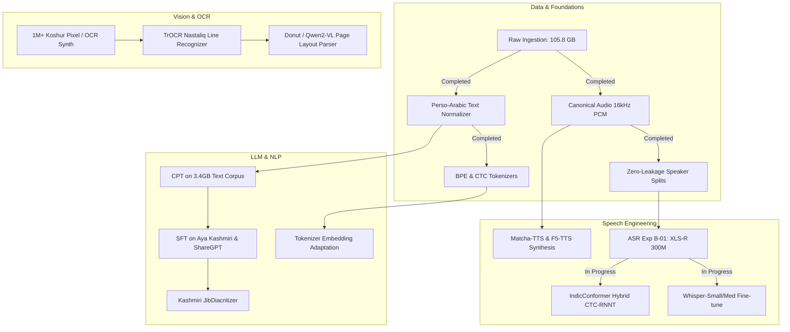

# KathAI (کتھ) — Master Research Index & Executive Summary

**Project**: KathAI (Kashmiri AI Multimodal Foundation Suite)  
**Author / Principal Investigator**: Musavir Khaliq & Research Team  
**Workspace**: `/home/musa/Kashmiri Project`  
**Repository**: `Musavirkhaliq/KathAI`  
**Date**: November 2026  
**Status**: Active Research & Controlled Phased Execution  

---

## 1. Executive Summary & Vision

Kashmiri (*Koshur* / کٲشُر / कॉशُر; ISO: `ks` / `kas`) is a Dardic Indo-Aryan language spoken by over 7 million native speakers in Jammu & Kashmir and the global diaspora. Despite its rich literary heritage spanning centuries (from Lal Ded and Sheikh-ul-Alam to modern literature), Kashmiri remains severely under-resourced in artificial intelligence, digital NLP, speech processing, and optical character recognition (OCR).

Existing commercial and open-source models fail abruptly on Kashmiri due to:
1. **Severe Orthographic & Phonological Complexity**: Kashmiri possesses 16–18 vowels, including phonemic central unrounded vowels (/ɨ/, /ɨː/, /ə/, /əː/) and contrastive palatalization offglides ([ʲ]). Blind diacritic stripping causes catastrophic homograph collision, while inconsistent keyboards and font rendering engines pollute text corpora.
2. **Extreme Tokenizer Inefficiency**: Standard Western and multilingual LLM tokenizers (Llama, Mistral, GPT-4) fragment Perso-Arabic Kashmiri into byte-level byte fallbacks, causing a crippling token fertility rate of **>4.1 tokens per word**. This inflates inference latency by 300% and halves the effective context window.
3. **Complex Cursive Typography for Document AI**: Kashmiri is predominantly written in the **Nastaliq** style of the Perso-Arabic script—characterized by context-sensitive sloping downward baselines, vertical ligature stacking, and intricate calligraphic rules—which renders standard Latin/Arabic horizontal bounding-box OCR engines (Tesseract, PaddleOCR) ineffective.
4. **Data Fragmentation & Evaluation Contamination**: Available audio and text sets were scattered, unstandardized, filled with low-SNR audio, and split arbitrarily with heavy speaker leakage that artificially deflated error rates.

**The KathAI Mission**: To construct the first comprehensive, research-grade, production-ready multimodal AI suite for Kashmiri. This suite spans:
- **Speech Technologies**: Real-time streaming ASR (IndicConformer), high-accuracy conversational ASR (Whisper-LoRA), multi-speaker neural TTS (Matcha-TTS, F5-TTS), and Speech Translation.
- **Language Models**: Kashmiri-native tokenizers (16k/32k BPE), Continued Pretrained (CPT) Foundation SLMs/LLMs, instruction-tuned conversational agents (Aya Kashmiri, ShareGPT), and automated diacritization models.
- **Vision & Document AI (OCR)**: Line-level and page-level Nastaliq & Naskh OCR models (TrOCR, Donut, Qwen2-VL), resolving historical and contemporary Kashmiri document digitization.
- **Translation & Transliteration**: High-BLEU bidirectional translation (IndicTrans2 fine-tunes) and bi-directional Perso-Arabic ↔ Devanagari ↔ Roman transliteration engines.

---

## 2. Master Navigation Index

This research repository contains an exhaustive, deeply verified audit of all work accomplished to date and step-by-step technical blueprints for building the complete model suite:

| Document | Primary Focus | Core Deliverables & Insights |
| :--- | :--- | :--- |
| [**01_WHAT_WE_HAVE_DONE_SO_FAR.md**](file:///home/musa/Kashmiri%20Project/research/01_WHAT_WE_HAVE_DONE_SO_FAR.md) | **Audit & Empirical Inventory** | 141.6h speech, 4.13M text lines, 344k parallel pairs, 131k lexicon entries, 1M+ OCR images. Strict speaker-disjoint splits, normalizers, tokenizers (BPE 8k–32k, CTC 161), and Experiment B-01 (Wav2Vec2 XLS-R) execution. |
| [**02_WHAT_WE_NEED_TO_DO_STEP_BY_STEP.md**](file:///home/musa/Kashmiri%20Project/research/02_WHAT_WE_NEED_TO_DO_STEP_BY_STEP.md) | **Immediate & Phased Roadmap** | Milestone-driven execution breakdown: Days 1–14 (Immediate), Weeks 3–8 (Medium-term), Months 2–6 (Long-term). Dependencies, compute budgets, and acceptance gates. |
| [**03_LANGUAGE_MODELS_PLAN_LLM_SLM.md**](file:///home/musa/Kashmiri%20Project/research/03_LANGUAGE_MODELS_PLAN_LLM_SLM.md) | **Kashmiri LLM / SLM Suite** | Tokenizer vocabulary merging (Qwen-2.5, Llama-3.1/3.2), CPT on 3.4GB corpus, SFT on Aya & ShareGPT, DPO alignment, automated vowel diacritizer, and Kashmiri benchmark evaluations. |
| [**04_SPEECH_MODELS_PLAN_ASR_TTS_ST.md**](file:///home/musa/Kashmiri%20Project/research/04_SPEECH_MODELS_PLAN_ASR_TTS_ST.md) | **Speech Suite (ASR, TTS, ST)** | IndicConformer CTC/RNNT, Whisper-LoRA fine-tuning, KenLM shallow fusion decoding, Matcha-TTS and F5-TTS multi-speaker synthesis, G2P phonemizer, and Speech-LLM voice agents. |
| [**05_OCR_AND_DOCUMENT_AI_PLAN.md**](file:///home/musa/Kashmiri%20Project/research/05_OCR_AND_DOCUMENT_AI_PLAN.md) | **OCR & Document Intelligence** | TrOCR and CRNN recognition on 1M+ synthetic Nastaliq/Naskh lines (Koshur Pixel, Koshur-OCR-Synth), Donut/Qwen2-VL page parsing, CRAFT text detection, and historical manuscript processing. |
| [**06_TRANSLATION_TRANSLITERATION_LEXICON_PLAN.md**](file:///home/musa/Kashmiri%20Project/research/06_TRANSLATION_TRANSLITERATION_LEXICON_PLAN.md) | **NMT, Transliteration & Lexicon** | IndicTrans2 / NLLB adaptation on 344k pairs, multi-script tri-directional transliteration (Perso-Arabic ↔ Devanagari ↔ Roman), Grierson Dictionary API graph, and POS/NER tagging. |
| [**07_COMPUTE_DEPLOYMENT_AND_ROADMAP.md**](file:///home/musa/Kashmiri%20Project/research/07_COMPUTE_DEPLOYMENT_AND_ROADMAP.md) | **Hardware, Serving & Export** | NVIDIA DGX GB10 / A100 training scripts, vLLM / ONNX / TensorRT / GGUF quantization, mobile Sherpa-ONNX deployment, and unified Gradio/FastAPI public demo platform. |

---

## 3. High-Level Status Matrix

| Workstream | Completed | In Progress | Planned / Next |
| :--- | :--- | :--- | :--- |
| **Data Ingestion & Audit** | 105.8 GB ingested; 141.6h audio, 4.13M text lines, 344k parallel pairs audited | Real-time deduplication | Continuous crawl of Kashmiri news & archives |
| **Audio Canonicalization** | 16kHz mono 16-bit PCM WAV standardization, VAD, SNR filtering | Automated batch repair | Dynamic background noise augmentation |
| **Splitting & Partitions** | Zero speaker leakage: `train`, `val`, `test` + 4 diagnostic slices | Integration into PyTorch loaders | Stratified dialect balancing |
| **Tokenization** | BPE 8k, 16k, 24k, 32k trained (fertility 1.63); 161 CTC vocab built | Embedding weight grafting | WordPiece and Unigram comparison |
| **ASR Models** | Exp B-01 (XLS-R 300M CTC) 2-epoch pilot executed (loss 14.21 -> 3.42) | Whisper-Small LoRA pilot | Full 50-epoch run, IndicConformer Hybrid CTC-RNNT |
| **TTS Synthesis** | Bolbosh & KTTS single-speaker manifests formatted | Phoneme dictionary extraction | Matcha-TTS OT-CFM training, F5-TTS voice cloning |
| **LLMs / SLMs** | Text corpus merged (3.4 GB), Aya Kashmiri SFT data cleaned | Qwen-2.5-1.5B tokenizer expansion | CPT training run, SFT with ChatML, DPO alignment |
| **OCR / Vision** | 613k Koshur Pixel + 285k SynthOCR downloaded & verified | TrOCR synthetic baseline setup | Line segmentation + fine-tuning on real Kashmiri prints |
| **Translation / Xlit** | 344k parallel corpus consolidated; Grierson Lexicon (131k) extracted | Rule-based transliterator prototype | IndicTrans2 LoRA fine-tune, IndicXlit integration |
| **Infrastructure** | DGX Spark GB10 environment configured; PyTorch + CUDA verified | Automated training bash daemons | vLLM / ONNX export, public Gradio multi-agent UI |

---
*Proceed to [01_WHAT_WE_HAVE_DONE_SO_FAR.md](file:///home/musa/Kashmiri%20Project/research/01_WHAT_WE_HAVE_DONE_SO_FAR.md) for the exhaustive technical inventory of all assets, experiments, and code developed.*
