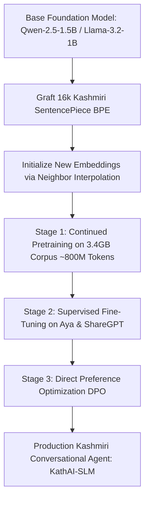

# KathAI (کتھ) — Kashmiri Language Models Plan (LLM & SLM Suite)

**Document**: Technical Design & Training Specification for Kashmiri Language Models  
**Path**: `research/03_LANGUAGE_MODELS_PLAN_LLM_SLM.md`  
**Repository**: `Musavirkhaliq/KathAI`  
**Date**: November 2026  

---

## 1. Architectural Strategy: Why Small Language Models (SLMs)?

Developing frontier foundational models (70B+) from scratch is computationally prohibitive for low-resource languages. However, modern 1.5B–8B Small Language Models (SLMs) such as **Qwen-2.5-1.5B/7B** and **Llama-3.2-1B/3B** offer state-of-the-art multilingual reasoning, transformer efficiency, and compact memory footprints that allow local deployment on consumer GPUs and edge hardware.

By implementing **Vocabulary Expansion**, **Continued Pretraining (CPT)** on our 3.4 GB corpus, and **Instruction SFT** on Aya Kashmiri, we can produce a native Kashmiri SLM that matches or outperforms multi-hundred-billion parameter generalist models on Kashmiri comprehension and generation.



---

## 2. Tokenizer Adaptation & Embedding Matrix Grafting

### 2.1 The Tokenizer Pathology
Standard LLMs fragment Perso-Arabic Kashmiri into single bytes, yielding an unacceptable token fertility:
$$\text{Fertility} = \frac{\text{Total Subword Tokens}}{\text{Total Whitespace Words}}$$
- **Llama-3 / GPT-4**: Fertility **> 4.10** (a 100-word sentence explodes to 410+ tokens).
- **KathAI Custom BPE-16k/32k**: Fertility **1.63** (the same 100-word sentence requires only 163 tokens).

### 2.2 Embedding Expansion Algorithm
1. **Vocabulary Merging**: Extract all unique subwords from our trained SentencePiece model `kashmiri_bpe_16k.model` that are missing from the base model's tokenizer.
2. **Matrix Resizing**: Expand the embedding tensor $\mathbf{W}_{\text{embed}} \in \mathbb{R}^{V_{\text{old}} \times d}$ to $\mathbf{W}_{\text{embed}}' \in \mathbb{R}^{(V_{\text{old}} + V_{\text{new}}) \times d}$, where $V_{\text{new}} \approx 12,000$ to $16,000$.
3. **Weight Initialization**: Rather than random gaussian initialization (which destabilizes existing pretraining during early gradient steps), newly added tokens are initialized using the mean embedding of their constituent character bytes in the base model:
   $$\mathbf{w}_{\text{new}} = \frac{1}{|C|} \sum_{c \in C} \mathbf{w}_c$$
4. **Target Architectures**:
   - Primary: `Qwen/Qwen2.5-1.5B` (RoPE theta 1,000,000, 32k context, high multilingual baseline).
   - Secondary: `meta-llama/Llama-3.2-3B` and `google/gemma-2-2b`.

---

## 3. Continued Pretraining (CPT) Specification

### 3.1 Data Mixture & Filtering (3.4 GB Corpus)
The training corpus (`kashmiri_dataset/merged/KASHMIRI-TEXT/kashmiri_text_corpus.jsonl`, 4.13M lines) is partitioned into a balanced curriculum:

| Data Segment | Source Datasets | Token Volume | Weight | Objective |
| :--- | :--- | :--- | :--- | :--- |
| **Organic Kashmiri Literature & Poetry** | Shruks of Lal Ded, Sheikh-ul-Alam, Habba Khatoon, Rasul Mir, Mahjoor | ~15M tokens | 15% | Linguistic depth, authentic grammar, central vowel cadence |
| **Kashmiri Wikipedia & Encyclopedic** | Wikimedia kswiki dumps (14,061 articles, 1.8M words) | ~25M tokens | 15% | Formal register, history, science, geography |
| **News & Modern Web Text** | Cleaned Kashmiri news, KS-PRET-5M, 3.1M pretraining corpus | ~350M tokens | 35% | Contemporary vocabulary, social discourse, technology |
| **Parallel Kashmiri-English Corpus** | SMUQamar 270k, Omarrran 49k, 1M translations | ~150M tokens | 20% | Cross-lingual alignment with `<ks_to_en>` and `<en_to_ks>` tags |
| **Scientific & Medical Kashmiri** | MaitreyaJayaraj Clinical & Math reasoning batches | ~60M tokens | 10% | Complex domain reasoning and technical synthesis |
| **Anchor English / Urdu Texts** | High-quality Wikipedia subsets | ~50M tokens | 5% | Prevents catastrophic forgetting of core logic |

### 3.2 Data Quality Filtering Pipeline
- **Script Cleanliness**: Utterances with >10% unknown non-Perso-Arabic glyphs stripped.
- **Deduplication**: 5-gram MinHash LSH with Jaccard similarity threshold $0.85$ to purge duplicated news syndications.
- **Perplexity Gating**: Filtering text using a KenLM model trained on classical Kashmiri literature to discard low-quality machine translations with severe grammatical malformations.

### 3.3 Training Hyperparameters (CPT)
- **Sequence Length**: 2048 tokens (packing multiple documents with attention masking).
- **Optimizer**: AdamW ($\beta_1 = 0.9, \beta_2 = 0.95, \epsilon = 10^{-8}$).
- **Learning Rate**: $2 \times 10^{-5}$ with Cosine Annealing decay down to $2 \times 10^{-6}$.
- **Warmup**: First 2,000 steps.
- **Weight Decay**: 0.01.
- **Precision**: bfloat16 / fp16 with FlashAttention-2.
- **Compute Budget**: ~24–36 hours on 4x NVIDIA A100 (80GB) or DGX Spark GB10.

---

## 4. Supervised Fine-Tuning (SFT) & Conversational Alignment

### 4.1 Instruction Tuning Corpora
The SFT stage equips the model with instruction-following, multi-turn conversational competence, and cultural factual alignment:
1. **Aya Kashmiri (Cohere For AI / HumairMunirAwn)**: 100,000+ instruction-response pairs covering summarization, factual QA, translation, creative writing, and reasoning.
2. **ShareGPT Kashmiri**: Multi-turn dialogue scenarios capturing colloquial Kashmiri conversational dynamics.
3. **Kashmiri Cultural & Linguistic Q&A**: Hand-curated 5,000 QA pairs regarding Kashmiri proverbs (*dapaan*), historical figures, traditional arts, cuisine, and geography.

### 4.2 Formatting & Loss Formulation
- Standard ChatML format:
  ```text
  <|im_start|>system
  تۄہِ چھِو کتھ (KathAI)، کٲشُر زَبانِ ہٕنٛدی اَکھ ذَہین مَدَتھ گار۔ تۄہِ کٔرِو پٔتھِ کَن کٲشِر زَبانہِ مَنٛز صَحیٖح اَدَب تہٕ عِلم سان جَواب۔<|im_end|>
  <|im_start|>user
  کٔشیٖرِ ہُنٛد ساروِی کھۄتہٕ بَڈ آبشار کۄس چھُ؟<|im_end|>
  <|im_start|>assistant
  کٔشیٖرِ ہُنٛد ساروِی کھۄتہٕ مَشہوٗر تہٕ تھۆد آبشار چھُ اَہَربَل آبشار، یُس کۄلگام ضِلَس مَنٛز واقَع چھُ...<|im_end|>
  ```
- **Masked Cross-Entropy Loss**: Gradients are backpropagated **solely on the assistant response tokens**, ignoring prompt and system instructions:
  $$\mathcal{L}_{\text{SFT}}(\theta) = -\sum_{t \in \text{assistant}} \log P_\theta(y_t \mid y_{<t}, x_{\text{prompt}})$$

### 4.3 Direct Preference Optimization (DPO)
To eliminate catastrophic drift into Urdu or Persian grammar:
- Construct paired preference datasets $(x, y_w, y_l)$:
  - Winner ($y_w$): Grammatically pure Kashmiri, correct ergative case markings (*-an*, *-as*), authentic central vowels (ٲ, ۄ).
  - Loser ($y_l$): Urdu loan-syntax, missing central vowels, or generic unhelpful hallucinations.
- Objective:
  $$\mathcal{L}_{\text{DPO}}(\theta; \pi_{\text{ref}}) = -\mathbb{E}_{(x, y_w, y_l)} \left[ \log \sigma \left( \beta \log \frac{\pi_\theta(y_w|x)}{\pi_{\text{ref}}(y_w|x)} - \beta \log \frac{\pi_\theta(y_l|x)}{\pi_{\text{ref}}(y_l|x)} \right) \right]$$

---

## 5. Dedicated Kashmiri Diacritization Model (Koshur-Diacritizer)

Because standard texts and social media rarely include Perso-Arabic vowel marks, an autonomous diacritizer is vital for downstream TTS and semantic search:
- **Architecture**: `ByT5-small` or `CanTK` character-level transformer (150M parameters).
- **Data**: `omarrran_kashmiri_parallel_diacratic_to_non_diacratic_text_dataset`.
- **Task**: Grapheme string $\to$ Fully diacritized string containing:
  - Central unrounded vowels: /ɨ/ (U+0672 ٲ) and /ə/ (Alef with Madda).
  - Palatalization marks: U+065A (small V above).
  - Short vowels: Zer (U+0650), Zabar (U+064E), Pesh (U+064F).
- **Inference Speed**: Batched ONNX runtime (<10ms per sentence).

---

## 6. Evaluation Framework & Benchmarks

| Benchmark | Task / Modality | Baseline / Target | Metric |
| :--- | :--- | :--- | :--- |
| **Kashmiri Belebele** | Multi-choice reading comprehension | Target: **> 65.0%** (outperforming mBERT/Llama-3 zero-shot) | Accuracy (%) |
| **Kashmiri MMLU (Translated)** | Multi-domain factual reasoning | Target: **> 52.0%** | Accuracy (%) |
| **Kashmiri Cultural QA (KathBench)** | Local history, idioms, literature | Target: **> 78.0%** | F1 / Exact Match |
| **Diacritization Benchmark** | Full vowel restoration | Target: **< 4.0% DER** (Diacritic Error Rate) | DER (%) |
| **Token Fertility Ratio** | Vocabulary efficiency | Target: **< 1.70** (vs 4.10 for Llama-3) | Tokens / Word |

---
*Proceed to [04_SPEECH_MODELS_PLAN_ASR_TTS_ST.md](file:///home/musa/Kashmiri%20Project/research/04_SPEECH_MODELS_PLAN_ASR_TTS_ST.md) for the end-to-end speech technologies specification.*
