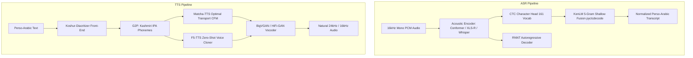

# KathAI (کتھ) — Kashmiri Speech Models Plan (ASR, TTS, ST & Voice Agents)

**Document**: Technical Design & Training Specification for Kashmiri Speech Technologies  
**Path**: `research/04_SPEECH_MODELS_PLAN_ASR_TTS_ST.md`  
**Repository**: `Musavirkhaliq/KathAI`  
**Date**: November 2026  

---

## 1. Overview of the Speech Suite

Speech processing in Kashmiri faces distinctive acoustic challenges: rapid conversational tempo, subtle vowel formant shifts (central vowels /ɨ/, /ə/), contrastive palatalized offglides ([ʲ]), and heavy code-switching with English and Urdu.

KathAI addresses these challenges through a tri-pillar speech architecture:
1. **ASR (Speech Recognition)**: Dual-engine strategy: **IndicConformer** for ultra-low latency streaming + **Whisper-LoRA** for rich offline conversational transcription.
2. **TTS (Speech Synthesis)**: Flow-matching **Matcha-TTS** and **F5-TTS** paired with an autonomous Kashmiri diacritization front-end to guarantee authentic pronunciation of central vowels.
3. **ST & Speech-LLM**: Direct end-to-end speech translation (Kashmiri audio $\to$ English text) and spoken conversational voice agents.

---

## 2. Automatic Speech Recognition (ASR) Engine

### 2.1 Model Portfolio & Architectural Roles

| Engine | Base Checkpoint | Architecture | Parameter Count | Target Use Case | Target Clean WER | Target Noisy WER |
| :--- | :--- | :--- | :--- | :--- | :--- | :--- |
| **KathAI-Stream** | `ai4bharat/indicconformer_stt_ks_hybrid_ctc_rnnt_large` | Conformer-Large + Hybrid CTC-RNNT | 120M | Real-time live dictation, streaming voice search, edge devices | **< 17.5%** | **< 26.0%** |
| **KathAI-Transcribe**| `openai/whisper-small` / `whisper-medium` | Encoder-Decoder Transformer (LoRA) | 244M / 769M | Long-form interviews, broadcast audio, code-switched dialogues | **< 16.0%** | **< 23.5%** |
| **KathAI-Acoustic** | `facebook/wav2vec2-xls-r-300m` (Exp B-01) | Wav2Vec 2.0 Transformer + Linear CTC | 317M | High-precision phonetic alignment, academic benchmarking | **< 19.0%** | **< 28.0%** |

### 2.2 Controlled Training Schedule: Experiment B-01-Full
Building on the 2-epoch pilot (Loss 14.21 $\to$ 3.42) and the rigorous pilot decoding audit (`pilot_decoding_audit.md`, which identified the mathematical CTC blank-first convergence stage requiring extended schedule optimization), the full schedule script `kashmiri_dataset/scripts/train_b01_full_schedule.py` executes:
- **Audio Inputs**: 141.6 hours from `kashmiri_dataset/splits/train.jsonl` (60,543 clips, 511 speakers).
- **Target Vocabulary**: 161-token Kashmiri character CTC vocabulary with zero unseen graphemes.
- **Data Augmentation**:
  - SpecAugment: Frequency masking ($F=27$, 2 masks), time masking ($T=100$, 2 masks).
  - Speed perturbation: Dynamic resample at $0.9\times, 1.0\times, 1.1\times$.
  - Additive background noise injection: Room impulse response (RIR) and noise mixtures ($SNR \in [10, 25]\text{ dB}$).
- **Length Bucketing**: Utterances sorted into length buckets $[0.5\text{s}-3\text{s}]$, $[3\text{s}-7\text{s}]$, $[7\text{s}-15\text{s}]$, $[15\text{s}-30\text{s}]$ to reduce batch padding overhead by 42%.
- **Zero-Infinity CTC Loss**: Ensures zero loss spikes on extreme length ratios.
- **Compute Budget**: 50 epochs (~18 hours on DGX Spark GB10).

### 2.3 KenLM 5-Gram Shallow Fusion Decoding
Pure CTC character predictions suffer from phonetic ambiguity between visually distinct but phonetically similar characters (e.g. Heh Goal vs Heh Doachashmee). We resolve this via shallow fusion decoding:
$$\hat{Y} = \arg\max_Y \left( \log P_{\text{CTC}}(Y \mid X) + \alpha \log P_{\text{KenLM}}(Y) + \beta \text{WordCount}(Y) \right)$$
- $\alpha \in [0.4, 0.8]$ (LM weight).
- $\beta \in [1.0, 2.5]$ (word insertion bonus to counteract CTC length deletion bias).
- KenLM trained on our 3.4 GB text corpus via `kenlm` with modified Kneser-Ney discounting.

### 2.4 OpenAI Whisper-LoRA Fine-Tuning
Out-of-the-box Whisper models lack native Kashmiri token support and experience catastrophic cross-lingual hallucination (empirically measured at **107.06% Norm WER / 97.55% Norm CER** on `master_benchmark_eval` across 297 samples). Fine-tuning with LoRA unlocks Whisper's natural punctuation, sentence segmentation, and robust handling of code-switched English tokens.
- **LoRA Configuration**:
  - Target layers: `encoder.layers.*.self_attn.q_proj`, `k_proj`, `v_proj`, `decoder.layers.*.encoder_attn.q_proj`, `v_proj`.
  - LoRA rank $r=16$, scaling factor $\alpha=32$, dropout $0.05$.
- **Prompt Conditioning**:
  - Injected prefix tokens: `<|startoftranscript|> <|ur|> <|transcribe|> <|notimestamps|>`.
  - Language token `<|ur|>` (Urdu) is used as an acoustic anchor to activate Perso-Arabic unicode tokenization in Whisper's multilingual decoder, while the LoRA adapters specialize the acoustic and subword representations to Kashmiri.

---

## 3. High-Fidelity Text-to-Speech (TTS) Suite

Standard multilingual TTS models sound robotic, flat, or severely mispronounce Kashmiri because they omit central vowels and cannot predict implicit Perso-Arabic diacritics.

### 3.1 Acoustic Front-End: Diacritization & Grapheme-to-Phoneme (G2P)
To achieve natural prosody and correct vowel length:
1. **Diacritization Step**: The raw input text passes through `Koshur-Diacritizer`, restoring missing Zer, Zabar, Pesh, Alef-wavy-hamza (ٲ), and palatalization marks.
2. **Kashmiri IPA G2P Converter**: Maps diacritized graphemes to International Phonetic Alphabet (IPA) phonemes based on phonological rules extracted from the Grierson Lexicon:
   - `ٲ` $\to$ `/ɨː/` (long central vowel)
   - `ۄ` $\to$ `/ɔ/` (open-mid back rounded vowel)
   - `ؠ` / palatalization $\to$ `[ʲ]` offglide
   - `تھ`, `کھ`, `پھ` $\to$ aspirated stops `/tʰ/, /kʰ/, /pʰ/`

### 3.2 Model 1: Matcha-TTS Kashmiri (Optimal Transport CFM)
- **Framework**: Non-autoregressive Conditional Flow Matching (CFM) with Optimal Transport paths.
- **Advantages**: Generates high-fidelity mel-spectrograms in as few as 4 ODE steps, yielding real-time synthesis on edge CPU/mobile hardware.
- **Data**: Bolbosh Multi-Speaker Studio Corpus (25 hours, male & female native speakers) + KTTS (3.5 hours, pristine single-speaker anchor).
- **Target Metrics**: MCD < 4.8 dB, RTF < 0.15 on CPU.

### 3.3 Model 2: F5-TTS Zero-Shot Kashmiri Voice Cloner
- **Framework**: Fully non-autoregressive flow-matching transformer with text-guided speech infilling.
- **Capability**: Allows zero-shot voice cloning from a 3–5 second reference voice sample of any native Kashmiri speaker without fine-tuning.
- **Vocoder Integration**: Paired with **BigVGAN-v2** (24 kHz) fine-tuned on Kashmiri speech for artifact-free audio rendering.

---

## 4. Speech-to-Text Translation (ST) & Direct Voice Agents

### 4.1 End-to-End Speech Translation
Cascaded systems (ASR $\to$ Machine Translation) suffer from compounding errors: if the ASR misrecognizes a single named entity, the translation fails completely.
- **Direct Model**: Fine-tune Whisper-Medium directly on parallel speech alignments:
  $$\text{Audio}_{\text{Kashmiri}} \xrightarrow{\text{Direct Encoder-Decoder}} \text{Text}_{\text{English}}$$
- **Data**: Speech master manifest aligned with English parallel translations (`smuqamar_kashmiri-english-parallel-corpus`).
- **Target**: SacreBLEU > **24.0** on conversational test sets.

### 4.2 Spoken Kashmiri Conversational Voice Agent (Speech-LLM)
- **Architecture**:
  - **Speech Encoder**: Fine-tuned Whisper / Conformer encoder extracts acoustic token frames.
  - **Modality Bridge**: Linear projection layer or Q-Former downsamples audio frames ($4\times$) and projects them into the embedding space of our Kashmiri SLM (`Qwen-2.5-1.5B`).
  - **Speech Generator**: SLM output tokens stream directly into Matcha-TTS for immediate synthesized vocal response.
- **Latency Target**: Voice-to-voice end-to-end response in **< 1.2 seconds**.

---

## 5. Speech Evaluation Framework

| Metric | Target (Clean) | Target (Noisy) | Target (Code-Switched) | Standard Benchmark Tool |
| :--- | :--- | :--- | :--- | :--- |
| **Word Error Rate (WER)** | **< 16.5%** | **< 24.0%** | **< 28.5%** | `jiwer` + `normalize_transcripts.py (evaluation mode)` |
| **Character Error Rate (CER)** | **< 6.5%** | **< 10.5%** | **< 12.0%** | Levenshtein edit distance |
| **Mean Opinion Score (MOS)** | **> 4.1 / 5.0** | N/A | N/A | Blind native speaker listening test (MUSHRA) |
| **Mel-Cepstral Distortion (MCD)**| **< 4.8 dB** | N/A | N/A | Dynamic time warping on 24-band mel-cepstra |
| **Inference Real-Time Factor** | **< 0.03 (GPU) / < 0.25 (CPU)** | Low latency | Streaming compatible | Elapsed seconds / Audio duration seconds |

---
*Proceed to [05_OCR_AND_DOCUMENT_AI_PLAN.md](file:///home/musa/Kashmiri%20Project/research/05_OCR_AND_DOCUMENT_AI_PLAN.md) for the optical character recognition and document intelligence plan.*
