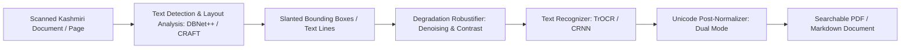

# KathAI (کتھ) — Kashmiri OCR & Document AI Plan

**Document**: Technical Design & Training Specification for Kashmiri Optical Character Recognition  
**Path**: `research/05_OCR_AND_DOCUMENT_AI_PLAN.md`  
**Repository**: `Musavirkhaliq/KathAI`  
**Date**: November 2026  

---

## 1. The Kashmiri OCR Challenge: Nastaliq Typography

Optical Character Recognition (OCR) for the Kashmiri language is among the most demanding computer vision tasks in Indic and Perso-Arabic NLP due to the calligraphic nature of **Nastaliq**:



### Why Standard OCR Engines Fail
1. **Sloping Non-Horizontal Baselines**: Unlike Latin or Naskh scripts where characters sit on a continuous horizontal baseline, Nastaliq words slope downward from right to left at angles between $25^\circ$ and $45^\circ$. Horizontal rectangular bounding boxes chop off adjacent words.
2. **Context-Sensitive Ligatures**: Glyphs dramatically change shape based on up to 4 surrounding characters, generating over **20,000 potential ligature forms**.
3. **Vertical Stacking**: Characters within a single word are stacked vertically (e.g. *چھِ*, *تَوٲریٖخ*).
4. **Kashmiri-Specific Diacritics**: Unique central vowel marks (Alef with wavy hamza ٲ `U+0672`, wavy hamza below `U+065F`, palatalization sign `U+065A`) are tiny, closely positioned dots and strokes that standard engines blur as noise.

---

## 2. Quantitative Inventory of OCR Datasets in KathAI

The repository contains an unprecedented collection of over **1,000,000 labeled Kashmiri OCR images** across multiple granularities:

| Dataset Name | Source Repository | Sample Count | Granularity / Formats | Fonts & Styles | License |
| :--- | :--- | :--- | :--- | :--- | :--- |
| **Koshur Pixel** | `omarrran_koshur_pixel` (arXiv:2606.23144) | **613,078** | Words, lines (378k), paragraphs (72k), pages (42k) | Gulmarg Nastaleeq, Afan Koshur Naksh | CC BY-ND 4.0 |
| **Koshur-OCR-Synth** | `faizaniqbal_koshur-ocr-synth` | **285,864** | Clean, high-res text lines (PNG + companion TXT) | Gulmarg Nastaleeq, Noto Nastaliq, Afan Naksh, Narqalam | Apache-2.0 |
| **Koshur-SynthOCR** | `faizaniqbal_koshur-synthocr` | **119,114** | Multi-font mixed shards (Parquet) | Afan Koshur Naksh, Gulmarg Nastaleeq | Open / CC |
| **31k Text Recognition** | `omarrran_31k_kashmiri_text_and_image...` | **31,200** | Line and word crops with bounding coordinates | Nastaliq and standard prints | Open |
| **One-Word Text Recognition**| `omarrran_kashmiri_one_word_text_...` | **15,000** | Word-level calligraphic crops | Diverse calligraphy | Open |
| **Total Labelled OCR Set** | Consolidated | **> 1,064,000** | **Full multi-scale hierarchy (word → page)** | **Complete typestyle coverage** | High Diversity |

---

## 3. Multi-Tiered OCR Model Architecture

To satisfy both high-throughput mobile applications and high-fidelity book digitization, KathAI deploys a three-tiered OCR suite:

### 3.1 Tier 1: High-Accuracy Line Recognizer (TrOCR Kashmiri)
- **Framework**: `microsoft/trocr-base-stage1` (Vision Transformer encoder + autoregressive text decoder).
- **Encoder**: ViT or BEiT patch projection ($16\times16$ patches, 384 hidden size).
- **Decoder**: Transformer decoder initialized with Perso-Arabic/Urdu subword embeddings and extended with our Kashmiri 161 CTC/character vocabulary.
- **Training Strategy**:
  - Pretrained on 285k lines of `faizaniqbal_koshur-ocr-synth`.
  - Fine-tuned on the 378k sentence lines of `omarrran_koshur_pixel` with realistic synthetic noise.
- **Target Accuracy**: Character Error Rate (CER) < **4.0%**, Word Accuracy > **94.0%**.

### 3.2 Tier 2: Ultra-Fast Edge Recognizer (CRNN + CTC)
- **Framework**: Convolutional Recurrent Neural Network (CRNN) with Connectionist Temporal Classification (CTC).
- **Backbone**: MobileNetV3 or lightweight ResNet-34 feature extractor $\to$ 2-layer Bidirectional LSTM (512 hidden) $\to$ Linear CTC projection (161 Kashmiri classes).
- **Inference Speed**: **< 15ms per line on CPU**; total model binary size < 25 MB.
- **Target Deployment**: Android / iOS camera scanners and real-time offline document reading.

### 3.3 Tier 3: End-to-End Page Parser & Layout Model (Donut / Qwen2-VL)
- **Framework**: `naver-clova-ix/donut-base` or `Qwen/Qwen2-VL-2B-Instruct`.
- **Functionality**: Eliminates the need for separate text line segmentation. The vision-language model takes the entire scanned page as an image and directly outputs structured markdown text preserving headers, paragraphs, poetry couplets, and footnotes.
- **Data**: Trained on the 42,679 page-level renders in `omarrran_koshur_pixel`.
- **Target Metric**: Normalized Edit Distance (1 - NED) > **0.88** on full page layouts.

---

## 4. Synthetic-to-Real Domain Adaptation Pipeline

While synthetic rendering provides perfect ground truth, real-world historical Kashmiri books (e.g. litograph prints, yellowed newspapers, government gazettes) feature physical degradation. 

### 4.1 Photometric & Geometric Degradation Generator
During training, raw synthetic images undergo dynamic online transformations:
1. **Paper Texture Emulation**: Blending scanned aged parchment textures, background foxing, and yellowing.
2. **Ink Bleed & Erosion**: Morphological dilation/erosion simulating uneven lithographic ink spread and broken character strokes.
3. **Perspective & Curvature Warping**: Thin-Plate Spline (TPS) transformations modeling page curvature near book spines.
4. **Sensor & Lighting Distortions**: Non-uniform illumination gradients, shadow casts, salt-and-pepper noise, and Gaussian motion blur.

```python
import albumentations as A

ocr_augmentation_pipeline = A.Compose([
    A.RandomBrightnessContrast(p=0.5),
    A.MotionBlur(blur_limit=(3, 7), p=0.3),
    A.GaussNoise(var_limit=(10.0, 50.0), p=0.4),
    A.Perspective(scale=(0.02, 0.08), p=0.3),
    A.ImageCompression(quality_range=(40, 90), p=0.4),
])
```

### 4.2 Benchmark Evaluation Corpus (Real Scans)
To ensure scientific validity, curate and human-verify a held-out test split of 500 real-world scanned pages from:
- *Sangarmal* (Kashmiri daily newspaper).
- *Sheeraza* (Bimonthly Kashmiri literary journal published by J&K Academy of Art, Culture and Languages).
- Classical 20th-century Kashmiri lithographic poetry books.

---

## 5. Text Line Detection & Page Layout Segmentation

Before line-level recognition can execute on arbitrary documents, lines must be accurately segmented:
- **Model**: **DBNet++** (Real-Time Scene Text Detection with Differentiable Binarization) fine-tuned on Kashmiri document layouts.
- **Orientation Handling**: Polygon contour detection capable of bounding angled Nastaliq text chunks without clipping upper or lower diacritics.

---

## 6. OCR Evaluation & Target Metrics

| Task | Model Architecture | Evaluation Metric | Baseline (Tesseract) | KathAI Target |
| :--- | :--- | :--- | :--- | :--- |
| **Synthetic Line OCR** | TrOCR-Kashmiri | Character Error Rate (CER) | ~42.0% | **< 3.5%** |
| **Synthetic Word OCR** | CRNN-CTC (Lightweight) | Word Accuracy (%) | ~51.0% | **> 92.0%** |
| **Real Scanned Book Lines** | TrOCR + Domain Aug | Character Error Rate (CER) | ~58.0% | **< 8.5%** |
| **Full Page Parsing** | Donut / Qwen2-VL | Tree Edit Distance (TED) | N/A (Fails) | **< 0.12** |
| **Inference Latency** | CRNN-CTC (CPU INT8) | Milliseconds per line | ~120 ms | **< 15 ms** |

---
*Proceed to [06_TRANSLATION_TRANSLITERATION_LEXICON_PLAN.md](file:///home/musa/Kashmiri%20Project/research/06_TRANSLATION_TRANSLITERATION_LEXICON_PLAN.md) for the translation, transliteration, and dictionary infrastructure.*
