# KathAI (کتھ) — Translation, Transliteration & Lexicon Infrastructure Plan

**Document**: Technical Specification for NMT, Multi-Script Transliteration, and Lexical Graph Systems  
**Path**: `research/06_TRANSLATION_TRANSLITERATION_LEXICON_PLAN.md`  
**Repository**: `Musavirkhaliq/KathAI`  
**Date**: November 2026  

---

## 1. Overview of Linguistic Tools & Infrastructure

Bridging Kashmiri with the global language ecosystem requires more than speech and OCR; it necessitates robust cross-lingual translation, multi-script interoperability, and structured lexical resources:

```mermaid
graph TD
    subgraph Multi-Script Transliteration
        Arab[Perso-Arabic: کٲشُر] <-->|Phonetic Bi-directional Engine| Deva[Devanagari: कॉशुर]
        Arab <-->|Phonetic Bi-directional Engine| Roman[Romanized Latin: Koshur]
        Deva <--> Roman
    end

    subgraph Neural Machine Translation
        Parallel[344k Parallel Corpus + Back-Translation] --> IT2[IndicTrans2 1B / Distilled 320M]
        IT2 --> TransOut[Bidirectional EN ↔ KS / UR ↔ KS / HI ↔ KS]
    end

    subgraph Lexical Knowledge Graph
        Grierson[Sir George Grierson Lexicon: 131k Entries] --> Parse[Morphological Parser & Lemmatizer]
        Parse --> API[Semantic Kashmiri Dictionary Graph API]
    end
```



---

## 2. Neural Machine Translation (NMT) Suite

### 2.1 Available Parallel Corpus (344,445 Verified Pairs)
The consolidated parallel corpus (`kashmiri_dataset/merged/KASHMIRI-PARALLEL/kashmiri_parallel_corpus.jsonl`, 90 MB) provides clean sentence alignments:
- `SMUQamar 270K`: Extensive Kashmiri–English conversational and literary parallel sentences.
- `Omarrran 49K`: Focused parallel corpus covering modern technical, news, and everyday discourse.
- `1M Translations`: Multi-way sentence pairs for transfer learning.

### 2.2 Model Architecture & Fine-Tuning
1. **Base Foundation**:
   - `ai4bharat/indictrans2-en-indic-1B` (English $\to$ Indian languages).
   - `ai4bharat/indictrans2-indic-indic-dist-320M` (Indian language $\to$ Indian language, including Kashmiri).
   - `facebook/nllb-200-distilled-600M` (Meta No Language Left Behind).
2. **Back-Translation Data Augmentation**:
   - Translate 1,000,000 sentences from our monolingual 3.4 GB text corpus (`kashmiri_text_corpus.jsonl`) into English using a baseline model.
   - Filter synthetic pairs using sentence embedding cosine similarity (LaBSE / LASER) with threshold $\ge 0.82$.
   - Incorporating back-translated data increases effective parallel training data to **> 1.3 million pairs**, dramatically reducing out-of-vocabulary hallucination.
3. **Target Metrics**:
   - English $\to$ Kashmiri: SacreBLEU **> 29.5**, chrF++ **> 55.0**.
   - Kashmiri $\to$ English: SacreBLEU **> 34.0**, chrF++ **> 60.0**.

---

## 3. Tri-Directional Multi-Script Transliteration Engine

Kashmiri is actively written in three distinct writing systems:
1. **Perso-Arabic (`kas_Arab`)**: The official state script in Jammu & Kashmir, used in education, newspapers, and literature.
2. **Devanagari (`kas_Deva`)**: Extensively used by the Kashmiri Hindu diaspora, featuring diacritic modifications (ॲ, ऑ, horizontal vowel bars).
3. **Romanized Latin (`kas_Latn`)**: Predominantly used by younger generations on mobile messaging and social media platforms.

### 3.1 Mapping Challenges & Resolution
- **Central Vowels**:
  - Perso-Arabic `U+0672` (ٲ) ⟷ Devanagari `U+0972` (ॲ) / `U+095F` ⟷ Roman `ö` or `eu`.
  - Perso-Arabic `U+06C4` (ۄ) ⟷ Devanagari `U+0911` (ऑ) ⟷ Roman `ô` or `o`.
- **Palatalization**:
  - Perso-Arabic `U+065A` / Yeh ligature ⟷ Devanagari halant + `य` ⟷ Roman `y` offglide (e.g. *kityāb*).
- **Aspirated Consonants**:
  - `کھ` ⟷ `ख` ⟷ `kh`.
  - `تھ` ⟷ `थ` ⟷ `th`.
  - `چھ` ⟷ `छ` ⟷ `tsh` / `chh`.

### 3.2 Dual-Tier Implementation
1. **Deterministic Rule-Based Phonetic Engine**:
   - Zero-latency character/ligature mapping using Unicode lookup tables for 100% predictable formal transliteration.
2. **Neural Sequence-to-Sequence Model (IndicXlit Adapter)**:
   - Handles informal, ambiguous Latin chat spelling (e.g. mapping "kya karakh chu" → "کیاہ کَرکھ چُھ").
   - Trained on `krish187653_rasa-kashmiri-codemixing-transliterations`.

---

## 4. Sir George Grierson Kashmiri Lexicon & Morphological Engine

### 4.1 Digitization of Grierson's Dictionary (131,231 Entries)
The master lexicon (`kashmiri_dataset/merged/KASHMIRI-LEXICON/kashmiri_master_lexicon.jsonl`, 51 MB) contains:
- Primary Perso-Arabic headword.
- Devanagari representation.
- Romanized phonetic transcription with Grierson diacritical notation.
- English definition, grammatical part of speech, and etymological roots (Dardic, Sanskrit, Persian, Arabic).
- Idiomatic usages and proverb citations.

### 4.2 Morphological Analyzer & Lemmatizer
Kashmiri has an intricate ergative case-marking system and extensive verbal inflections (e.g. absolute past vs proximate past vs habitual past).
- Develop a rule-based and neural stemmer that maps complex verb forms back to the infinitive (ending in *-un* /-ُن, e.g. *khasun* خَسُن "to climb"):
  ```text
  khasyoov (خَسِیوو)  ──(Lemmatize)──>  khasun (خَسُن)
  khats (خَژ)         ──(Lemmatize)──>  khasun (خَسُن)
  ```

### 4.3 Structured Search API & Knowledge Graph
Expose the dictionary via a high-performance REST / GraphQL API supporting:
- Fuzzy multi-script search (input in Roman, Perso-Arabic, or Devanagari).
- Synonym and antonym graph traversals.
- Exact phonetic pronunciation guides for G2P and TTS front-ends.

---

## 5. Token Classification: POS Tagging & Named Entity Recognition (NER)

- **Foundation Encoders**: `ai4bharat/indic-bert` and `microsoft/mdeberta-v3-base`.
- **Tasks**:
  - **Part-of-Speech (POS)**: Universal Dependencies (UD) tagset adapted for Kashmiri syntax (including V2 word order - verb second position).
  - **Named Entity Recognition (NER)**: Extract Persons, Locations (Kashmiri districts, valleys, shrines), Organizations, Dates, and Cultural Terms.
- **Target F1-Score**: > **86.0%** across held-out news articles.

---
*Proceed to [07_COMPUTE_DEPLOYMENT_AND_ROADMAP.md](file:///home/musa/Kashmiri%20Project/research/07_COMPUTE_DEPLOYMENT_AND_ROADMAP.md) for compute infrastructure, model quantization, and edge deployment.*
