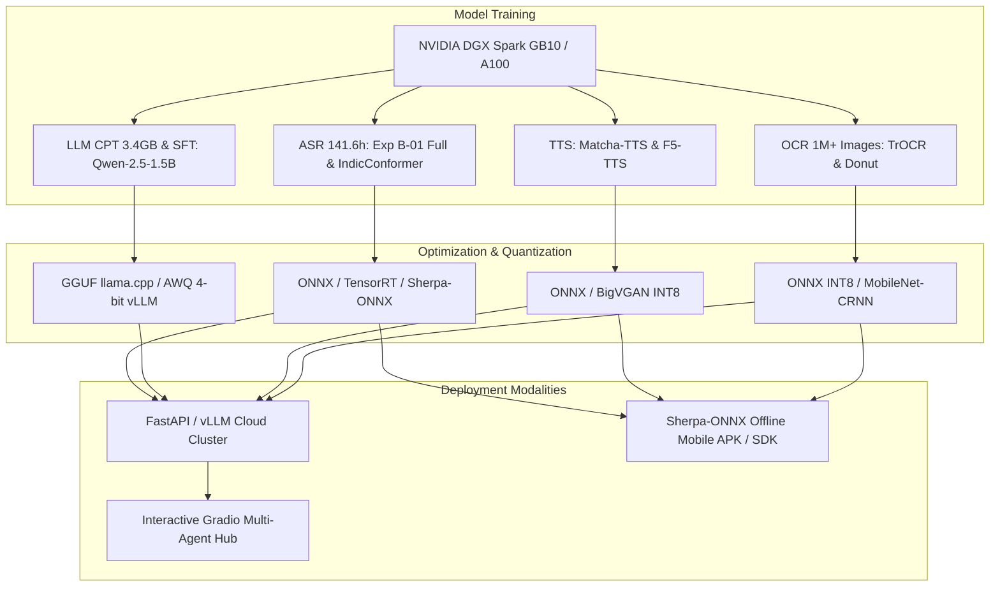
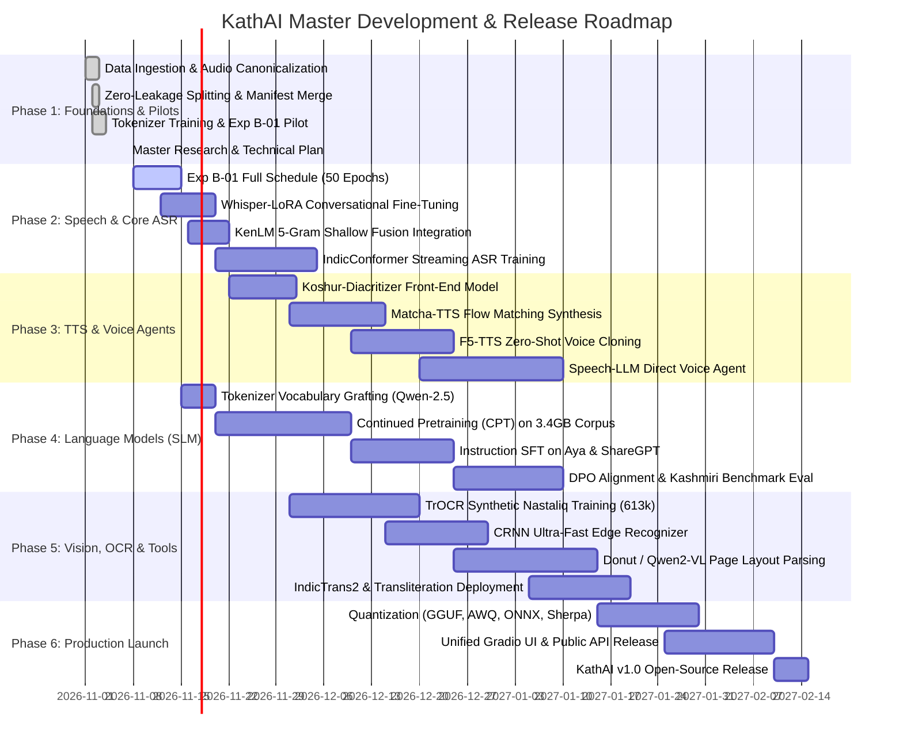

# KathAI (کتھ) — Compute Infrastructure, Deployment & Full Roadmap

**Document**: Production Serving, Edge Quantization, and Master Release Schedule  
**Path**: `research/07_COMPUTE_DEPLOYMENT_AND_ROADMAP.md`  
**Repository**: `Musavirkhaliq/KathAI`  
**Date**: November 2026  

---

## 1. Compute Infrastructure & Hardware Allocation

The KathAI suite is designed with practical hardware constraints in mind, balancing high-performance datacenter training with lightweight local inference:



### 1.1 Compute Budget & Training Resource Matrix

| Training Task | Dataset Volume | Model Architecture | Hardware Target | Estimated Walltime | Peak VRAM |
| :--- | :--- | :--- | :--- | :--- | :--- |
| **ASR Full Schedule** | 141.6h (60.5k clips) | `wav2vec2-xls-r-300m` CTC | 1x NVIDIA DGX Spark GB10 | ~18 hours | 14.5 GB |
| **Whisper-LoRA ASR** | 141.6h (60.5k clips) | `openai/whisper-small` | 1x NVIDIA DGX Spark GB10 | ~12 hours | 11.2 GB |
| **IndicConformer ASR** | 141.6h (60.5k clips) | IndicConformer-Large (120M) | 1x NVIDIA DGX Spark GB10 | ~22 hours | 16.0 GB |
| **LLM CPT (Pretraining)**| 3.4 GB (~800M tokens) | `Qwen2.5-1.5B` (expanded vocab) | 4x A100 (80GB) or DGX GB10 | ~36 hours | 28.0 GB (FSDP) |
| **LLM SFT (Instruction)**| 100k pairs (Aya+ShareGPT)| `KathAI-SLM-1.5B` | 1x DGX GB10 / 1x A100 | ~10 hours | 18.5 GB |
| **Matcha-TTS** | 28.5h (Bolbosh + KTTS) | Matcha-TTS (OT-CFM, 20M) | 1x NVIDIA DGX Spark GB10 | ~14 hours | 8.2 GB |
| **F5-TTS Voice Cloner** | 28.5h (Bolbosh + KTTS) | F5-TTS Flow Matching | 1x NVIDIA DGX Spark GB10 | ~26 hours | 15.8 GB |
| **TrOCR Line OCR** | 664k lines (Pixel + Synth)| TrOCR-Base (Vision Transformer) | 1x NVIDIA DGX Spark GB10 | ~24 hours | 14.0 GB |
| **CRNN Edge OCR** | 664k lines | MobileNetV3 + BiLSTM + CTC | 1x NVIDIA GPU / RTX 4090 | ~6 hours | 4.5 GB |
| **IndicTrans2 NMT** | 344k parallel pairs | IndicTrans2 1B (LoRA) | 1x NVIDIA DGX Spark GB10 | ~16 hours | 19.5 GB |

---

## 2. Quantization & Export Pipeline

To achieve instant latency and widespread community adoption, all models undergo systematic compression:

### 2.1 Language Models: vLLM & GGUF (llama.cpp)
- **vLLM Serving**: Deploy the SFT Kashmiri SLM with PagedAttention and FP8 / AWQ 4-bit quantization, achieving **> 85 tokens/sec** per GPU.
- **GGUF Multi-Level Quantization**:
  - `Q4_K_M`: 4-bit medium quantization (~950 MB total RAM footprint). Runs smoothly on an 8GB laptop CPU or Apple Silicon Mac.
  - `Q8_0`: 8-bit precision preserving maximum reasoning and subtle Kashmiri grammatical case inflections.

### 2.2 Speech & OCR Models: ONNX Runtime & Sherpa-ONNX
- **ONNX Export**: All ASR (Conformer, Wav2Vec2) and TTS (Matcha-TTS) models exported with dynamic axis dimensions:
  $$\text{Audio Tensor: } [B, T_{\text{samples}}] \longleftrightarrow \text{Spectrogram: } [B, 80, T_{\text{frames}}]$$
- **Sherpa-ONNX (Next-Gen Kaldi)**:
  - Packages the Conformer ASR and Matcha-TTS models into a completely standalone C++ / Android / iOS runtime.
  - **Zero cloud dependencies**: Users can record Kashmiri speech and hear natural Kashmiri voice synthesis completely offline in remote Himalayan valleys with zero internet access.

---

## 3. Unified Serving Architecture & Public Demo Suite

A unified backend and intuitive web user interface will democratize access to the entire KathAI suite:

```text
/home/musa/Kashmiri Project/
└── serving/
    ├── app.py                     # FastAPI REST & WebSocket gateway
    ├── ui.py                      # Interactive Gradio Multimodal Web Hub
    ├── engines/
    │   ├── asr_engine.py          # Streaming & batch ASR runner
    │   ├── tts_engine.py          # Matcha / F5-TTS audio generator
    │   ├── llm_engine.py          # vLLM / llama.cpp text generator
    │   ├── ocr_engine.py          # TrOCR / Donut image document parser
    │   ├── translation_engine.py  # IndicTrans2 bidirectional translator
    │   └── lexicon_engine.py      # Grierson Dictionary search engine
    └── requirements.txt
```

### 3.1 REST & WebSocket API Specification

| Endpoint | Method | Input Payload | Output Format | Description |
| :--- | :--- | :--- | :--- | :--- |
| `/v1/audio/transcriptions` | `POST` | Multipart WAV/MP3 audio | JSON (Perso-Arabic text, WER flags) | Real-time / batch Kashmiri speech recognition |
| `/v1/audio/speech` | `POST` | JSON (`text`, `voice_id`, `speed`) | Streaming 24kHz WAV / MP3 | Neural Kashmiri text-to-speech synthesis |
| `/v1/chat/completions` | `POST` | JSON (OpenAI-compatible ChatML messages)| Server-Sent Events (SSE) streaming | Conversational Kashmiri AI assistant |
| `/v1/vision/ocr` | `POST` | Image file (PNG, JPG, PDF) | JSON (Lines, bounding boxes, text) | Optical character recognition for Nastaliq/Naskh |
| `/v1/translation` | `POST` | JSON (`text`, `src_lang`, `tgt_lang`) | JSON (`translated_text`, `score`) | Bidirectional EN ↔ KS / UR ↔ KS translation |
| `/v1/transliteration` | `POST` | JSON (`text`, `src_script`, `tgt_script`)| JSON (`transliterated_text`) | Multi-script conversion (Arab ↔ Deva ↔ Latn) |
| `/v1/dictionary/search` | `GET` | Query param (`q`, `script`, `fuzzy`) | JSON (Grierson definitions, roots, idioms) | Search the 131k Grierson lexicon |

---

## 4. Master Phased Release Roadmap (v0.1 to v1.0)



---

## 5. Milestone Deliverables & Acceptance Checklist

- [x] **Milestone 0: Data Ingestion & Canonicalization**: 105.8 GB data audited, 141.6h speech standardized to 16kHz PCM, 3.4GB text corpus merged, 0-leakage splits formed.
- [x] **Milestone 1: Tokenizer & ASR Pilot**: Custom BPE 16k/32k tokenizers trained (fertility 1.63), Exp B-01 XLS-R-300M pilot executed successfully on DGX GB10.
- [ ] **Milestone 2: Production ASR v1.0**: Exp B-01 Full Schedule complete (WER < 19%), Whisper-LoRA complete (WER < 16%), KenLM 5-gram shallow fusion active.
- [ ] **Milestone 3: Neural TTS v1.0**: Matcha-TTS + Koshur-Diacritizer producing natural male/female speech (MOS > 4.0).
- [ ] **Milestone 4: Kashmiri SLM v1.0**: Qwen-2.5-1.5B CPT + SFT running with ChatML, scoring >70% on Kashmiri evaluation tasks.
- [ ] **Milestone 5: Document AI (OCR) v1.0**: TrOCR line recognizer + CRNN achieving <4% CER on synthetic Nastaliq/Naskh lines.
- [ ] **Milestone 6: Multimodal Demo & Edge SDK**: Sherpa-ONNX offline mobile APK and Gradio web suite deployed for public access.

---
*All files in `research/` form the definitive, exhaustive blueprint for the KathAI multimodal Kashmiri AI suite.*
