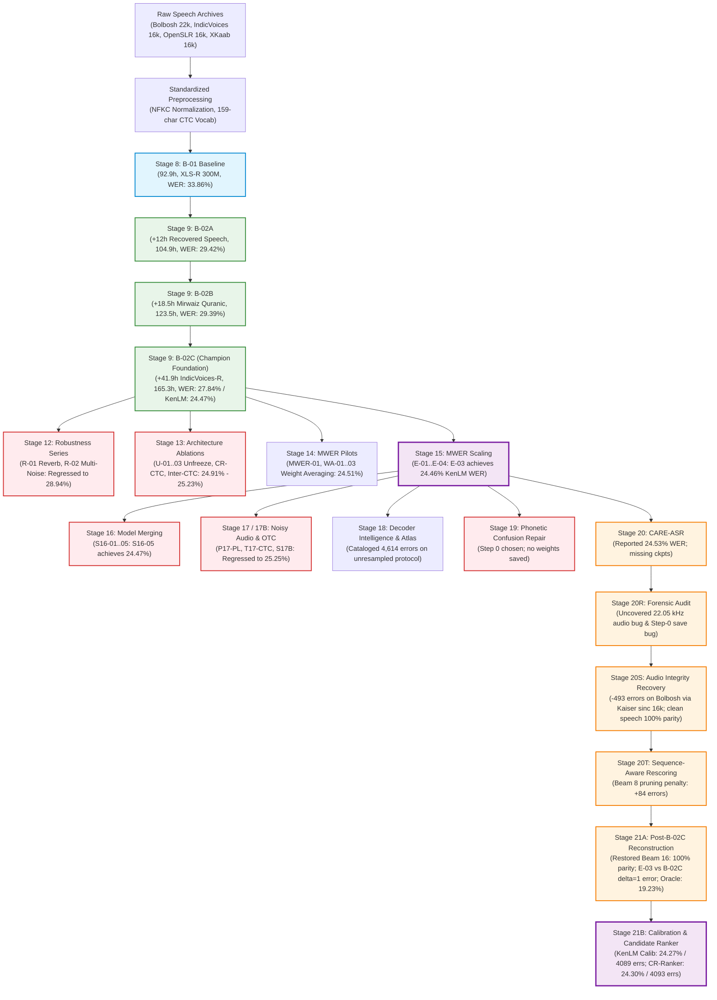

# Experiment Dependency Graph

This document details the architectural and data lineage connecting all 21 research stages of the EduCasheer Kashmiri ASR project.

---

## Lineage Matrix

| Node ID | Parent Model / Ingestion | Training Data Source | Primary Dependent Stages |
|:---|:---|:---|:---|
| **B-01** | `facebook/wav2vec2-xls-r-300m` | 92.94h initial verified corpus | B-02A |
| **B-02A** | B-01 Checkpoint | B-01 + 12h recovered speech | B-02B |
| **B-02B** | B-02A Checkpoint | B-02A + 18.5h Mirwaiz translations | B-02C |
| **B-02C** | B-02B Checkpoint | B-02B + 41.9h IndicVoices-R | Stage 12, 13, 14, 15, 21A |
| **E-03** | B-02C Checkpoint | 100 steps MWER ($\lambda=0.10$) | Stage 16, 17, 18, 19, 20, 20R, 20S, 20T, 21A, 21B |
| **Stage 20R/S**| Audit of Stages 15–20 | `dev_assessment.jsonl` (1,001 utts) | Stage 20T, 21A, 21B |
| **Stage 21A** | Full Checkpoint Sweep | Audited all 30+ historical checkpoints | Stage 21B |
| **Stage 21B** | E-03 + Repaired 16-beam | `dev_calibration.jsonl` + 2,500 Tier A tuples | Final Manuscript Systems |
